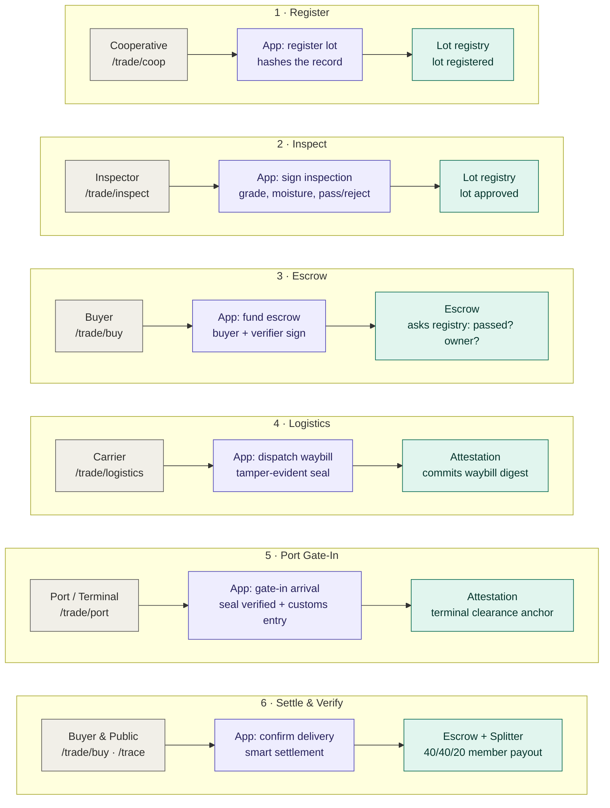
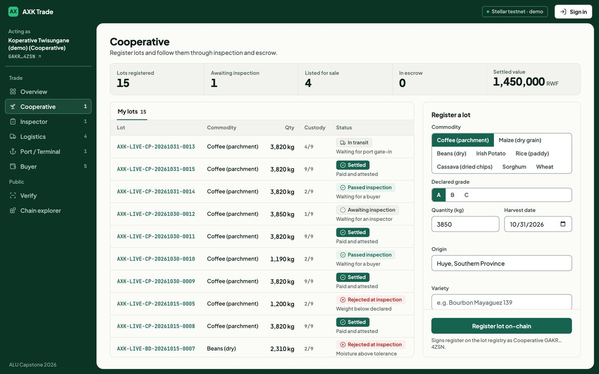
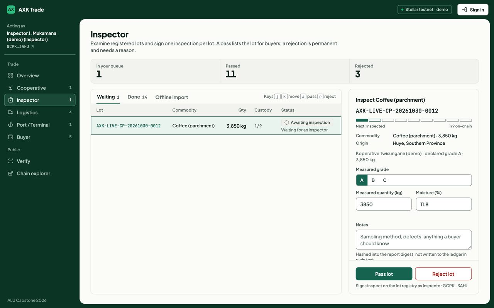
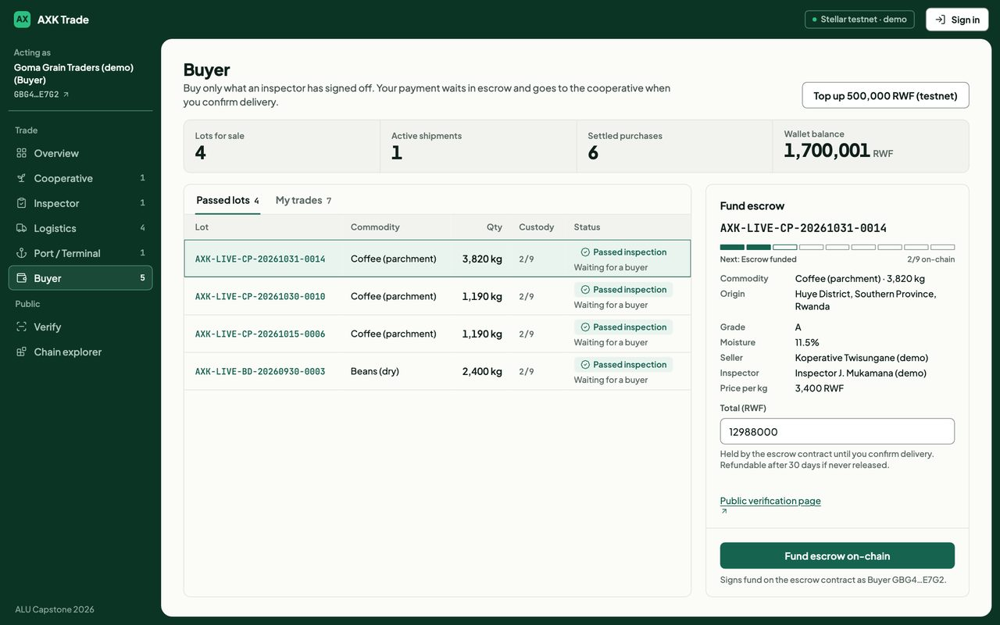
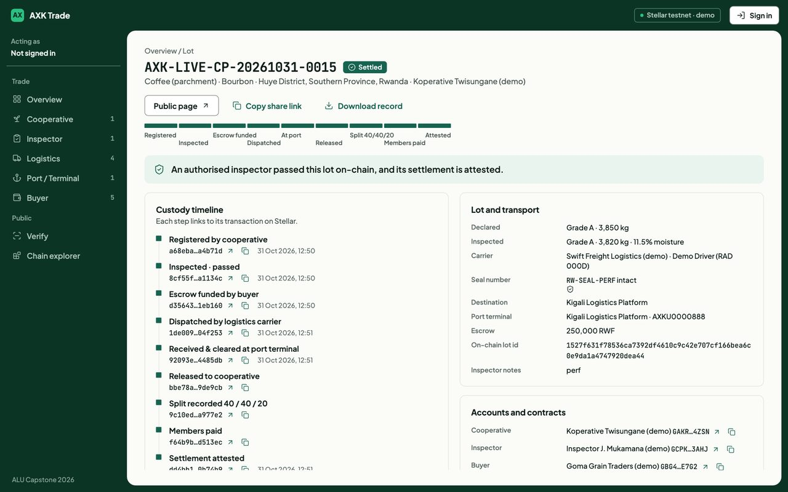
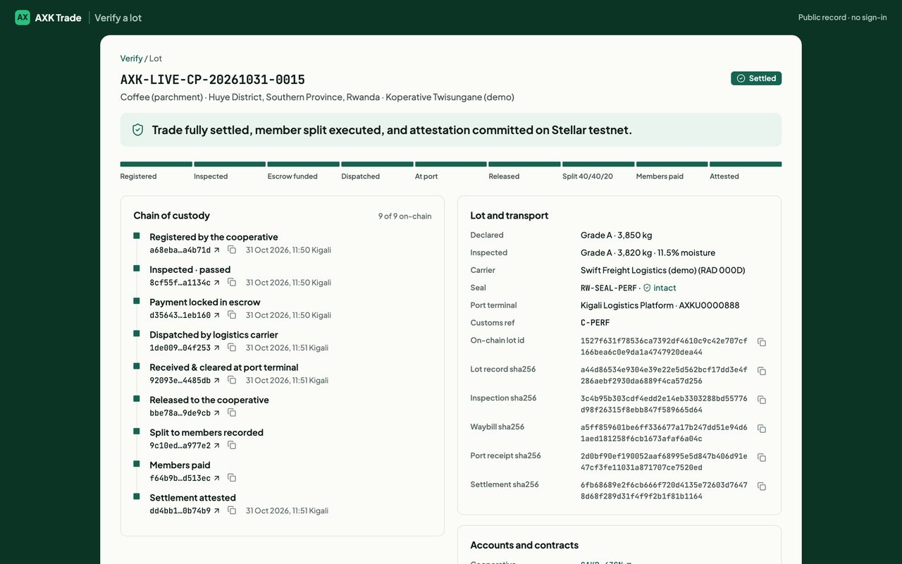
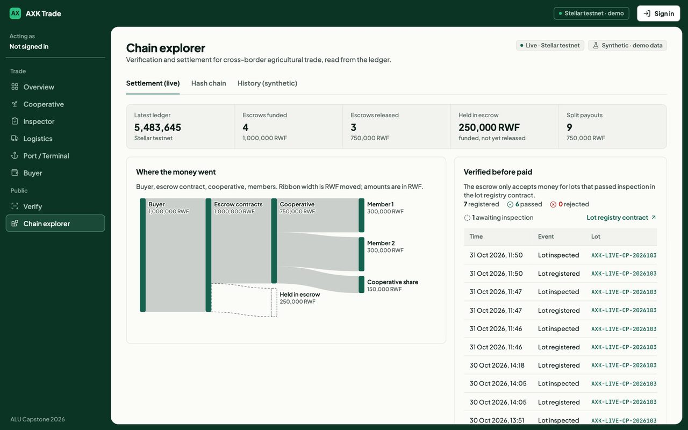

# AXK Network — Verification & Settlement Layer

**Capstone project · BSE Software Engineering (Low-Level / Blockchain track) · African Leadership University · 2026**
Oghenetejiri Jesse · Supervisor: Junior Turatsinze

Cross-border agricultural trade in East Africa fails at two points: a buyer cannot verify a lot's quality,
custody and container integrity across a corridor, and settlement is slow, costly and hard to trust. This project
puts both in one verified workflow on Stellar. A cooperative registers a lot; an independent inspector signs it
off on-chain; a buyer locks payment into smart-contract escrow; a carrier records dispatch under a container seal;
the port/terminal checks the seal against the waybill and records clearance; and on delivery confirmation the
contracts release payment, split it between members and write an attestation that anyone can check via QR code.

- **Repository:** https://github.com/tejirijesse/axk-open-source-capstone
- **Open source:** MIT licensed and open to contributions — see [CONTRIBUTING.md](CONTRIBUTING.md) and the
  step-by-step [ROADMAP.md](ROADMAP.md) (starter to advanced items for every stage of the trade).
- **Demo video:** link to be added (video files are not stored in the repository).
- **Pilot scope (planned):** Kigali cooperatives on the Rwanda–DRC and Rwanda–Uganda corridors. The field pilot
  has not been run yet; nothing in this repository is pilot evidence.

---

## How it works

One trade, top to bottom. In each step a participant acts (grey), the application layer signs/hashes the transaction
(purple), and Soroban contracts on Stellar testnet enforce the rules and custody timeline (green).



1. **Register.** The cooperative commits a SHA-256 digest of the lot record; only the digest goes on-chain.
2. **Inspect.** An authorised independent inspector signs one pass or reject with moisture & grade readings. Permanent & tamper-evident.
3. **Escrow.** The buyer funds escrow; locked funds are bound to the verified cooperative payee.
4. **Logistics.** The carrier records dispatch: driver, vehicle, container seal. A digest of the waybill is attested on-chain.
5. **Port / Terminal.** At gate-in the application checks the arriving seal against the waybill and records the customs
   reference; a digest of the port receipt is attested on-chain.

The dispatch and port attestations are signed by the AXK verifier key on the carrier's and port's behalf, and the
seal match is an application check, not a contract rule. Making carriers and ports sign for themselves is roadmap
work (LOG-4, PORT-1).
6. **Settle & Verify.** Delivery confirmation releases escrow, records the 40/40/20 cooperative member split, and anchors the final attestation. Anyone can inspect the complete timeline at `/trace` with zero login.

Full schematic, message sequence, state machines and data model: [docs/architecture.md](docs/architecture.md).

## What it does

| Role | Screen | What happens on-chain |
|---|---|---|
| Cooperative | `/trade/coop` | Registers agricultural lots: commits SHA-256 digest of lot record to **lot registry** bound to cooperative address |
| Inspector | `/trade/inspect` | Physical & lab grading queue: signs immutable pass/reject attestation with grade, moisture and sample notes |
| Logistics | `/trade/logistics` | Dispatch: driver, vehicle plate and container seal; the waybill digest is attested (verifier key) |
| Port / Terminal | `/trade/port` | Gate-in: seal checked against the waybill (application), customs reference; the port receipt digest is attested (verifier key) |
| Buyer | `/trade/buy` | Escrow & settlement: funds smart-contract escrow, confirms delivery release, triggers **splitter** (40/40/20 member payout) and final **attestation** |
| Anyone | `/trace` | Public verification: look up by reference, hash or scan QR code; checks the lot, waybill, port receipt and settlement digests; no personal data |
| Anyone | `/chain` | Chain Explorer: live Stellar testnet money flow, custody milestones, in-browser hash-chain verifier, and a synthetic 5-year history |

The five operational roles represent the practical core of AXK's physical and financial cross-border trade workflow.

## Screenshots

| | |
|---|---|
|  **Cooperative** — register a lot, follow it to payment |  **Inspector** — oldest-first queue, measured values, pass or reject with a reason (j/k/a/r keys) |
|  **Buyer** — inspected lots only, escrow, confirm delivery, download the verified record, share a link |  **Lot** — nine-step timeline, records re-hashed in the browser and confirmed by the contracts |
|  **Public trace** — read-only verification with QR, no login |  **Chain explorer** — live Stellar testnet flow and verification events |

## Designs

- [System schematic, trade sequence, state machines and data model](docs/architecture.md)
- [Security: roles, 14 contract guarantees and the test that pins each, application controls, known limits](docs/security.md)
- [Contract reference and design rationale](contracts/README.md)
- [Testnet deployments and what was exercised on-chain](docs/deployments.md)
- [Reference projects: open standards and open-source projects AXK learns from](docs/references.md)

## Tech stack

| Layer | Technology |
|---|---|
| Smart contracts | Rust, Soroban (`soroban-sdk` 22), `wasm32v1-none` — lot registry, escrow, splitter, attestation |
| Chain | Stellar testnet; RWF test token (Stellar Asset Contract) as the local-currency stand-in |
| Signing | `stellar-cli` 28, custodial per-role testnet identities |
| Application | Frappe v15 (ERPNext not required), Python 3.11, MariaDB 10.11, Redis |
| Frontend | Frappe web pages, vanilla JavaScript, hand-built SVG charts (no chart library) |
| Chain reads | `stellar-sdk` (Python) against Soroban RPC |

## Repository layout

```
contracts/            Soroban workspace: lot_registry, escrow, splitter, attestation (65 tests)
frappe_app/axk_capstone/
  axk_capstone/chain.py        custodial signer: every contract call, argument lists, no shell
  axk_capstone/trade_api.py    role endpoints and the access guard
  axk_capstone/verify.py       public lookup, PII-free fields, QR
  axk_capstone/stellar_live.py Soroban RPC event reader for the explorer
  axk_capstone/www/            /trade/*, /trace/*, /chain pages
  axk_capstone/public/         axk.css, trade.js, chain.css, chain.js
axk_seed/             synthetic five-year dataset + importer (labelled synthetic everywhere)
scripts/demo.sh       deploys fresh contracts and runs one verified trade on testnet
scripts/run-frappe.sh starts the local Frappe stack
scripts/server.py     offline simulation of the screens (no blockchain)
scripts/test_trade.py end-to-end lifecycle and failure-mode tests
docs/                 architecture, security, deployments, references, history dataset, screenshots
.github/              issue and pull request templates
ROADMAP.md            step-by-step contribution tracks for every stage of the trade
CONTRIBUTING.md       setup, workflow and project rules
Makefile              one command per task (`make help`)
```

## Quickstart & Setup

There are two ways to run it. Only the full stack touches the blockchain.

| | Full stack — **use this to evaluate** | Offline simulation |
|---|---|---|
| Command | `make run-frappe` | `make run` |
| Blockchain | Every action is a real Stellar testnet transaction | **None.** Hashes are computed locally and shown as *simulated* |
| Needs | Frappe v15 bench, MariaDB, Redis, Rust, stellar-cli | Python 3 only |
| Good for | Seeing the real system; anything touching contracts or `chain.py` | A quick look at the screens; UI contributions |

### Full stack (Stellar testnet)

Tested on macOS 15 (Apple silicon) with Homebrew. ERPNext and AXK's platform app are **not** needed.

```bash
git clone https://github.com/tejirijesse/axk-open-source-capstone.git && cd axk-open-source-capstone

# 1. contracts
make toolchain          # rustup, wasm32v1-none, stellar-cli
make test-contracts     # 65 tests
make build
make demo               # deploys fresh contracts + funded testnet accounts, runs one verified trade

# 2. a Frappe v15 bench (once): https://frappeframework.com/docs/user/en/installation
#    bench init axk-bench --frappe-branch version-15 && cd axk-bench
#    bench new-site axk.localhost && bench use axk.localhost
#    The Makefile looks for the bench at ../axk-bench; elsewhere, add BENCH=/path/to/axk-bench to each make command.

# 3. the app, pointed at the contracts from `make demo`
make install-app        # or: make install-app BENCH=/path/to/axk-bench
make contracts-config
bench --site axk.localhost set-config axk_demo_mode 1   # local development only

# 4. run
make run-frappe         # http://localhost:8000/trade
```

Demo mode lets the screens sign without logging in, **only for requests made directly on your own machine**;
anything arriving through a proxy or tunnel is refused. Turn it off on any shared host.

### Offline simulation (no blockchain)

```bash
make run                # or: python3 scripts/server.py — http://localhost:8000/trade
```

The same screens with locally generated sample data. It signs nothing and says so on every page.

### Pages

| Page | URL |
|---|---|
| Overview | `http://localhost:8000/trade` |
| Cooperative · Inspector · Buyer | `/trade/coop` · `/trade/inspect` · `/trade/buy` |
| Logistics · Port / Terminal | `/trade/logistics` · `/trade/port` |
| Public verification (no login) | `/trace` |
| Chain explorer | `/chain` |

Safari does not resolve `*.localhost`; use `http://localhost:8000`. The bare `/` on a site that also runs AXK's
platform app is that app's login page, not the capstone.

## Testing

Run the contract tests and the end-to-end tests together. The end-to-end tests need a server on
`localhost:8000` (`make run-frappe` or `make run`) in another terminal:

```bash
make test
```

- **Contract Tests (65 tests):** Soroban workspace unit tests covering 14 security guarantees across `axk_lot_registry`, `axk_escrow`, `axk_splitter`, and `axk_attestation`.
- **Integration Tests (7 tests):** `scripts/test_trade.py` exercises the full lifecycle and failure modes (inspection rejection, container seal tampering, invalid state transitions, unknown lots) against whatever is serving `localhost:8000`. Against the full stack every step is a real testnet transaction; against the simulation nothing is.

You can also run them independently:
```bash
make test-contracts    # Cargo test suite (65 tests)
make test-python       # Python integration & failure-mode suite (7 tests)
```

---

## Walkthrough

1. **Cooperative** (`/trade/coop`): Register a commodity lot (e.g., Beans, grade A, 8,000 kg). Canonical digest committed on-chain.
2. **Inspector** (`/trade/inspect`): Grade the lot, measure moisture, and sign an approval or rejection.
3. **Buyer** (`/trade/buy`): Deposit funds into smart-contract escrow. Funds are locked strictly for the registered cooperative.
4. **Logistics** (`/trade/logistics`): Dispatch with driver, vehicle plate and container seal; the waybill digest is attested.
5. **Port / Terminal** (`/trade/port`): Gate-in; the seal is checked against the waybill and the port receipt digest is attested.
6. **Buyer** (`/trade/buy`): Buyer confirms delivery. Escrow releases, the splitter records the 40/40/20 split, members are paid and the settlement attestation is written on Stellar testnet.
7. **Public trace** (`/trace`): Share link or scan QR code; instant cryptographic verification without login or personal data exposure.
8. **Chain explorer** (`/chain`): Live Stellar testnet money flow and ledger events; tamper with a synthetic event to see the cryptographic hash chain break.

## Test Matrix

| Suite | Count | Focus / Guarantees | Command |
|---|---|---|---|
| **Lot registry** | 18 | Write-once registration, authorized inspectors, admin controls | `cargo test -p axk-lot-registry` |
| **Escrow** | 27 | Inspection gating, buyer authorization, fixed payee, refund timeouts | `cargo test -p axk-escrow` |
| **Splitter** | 12 | Exact 40/40/20 division, rounding remainder protection, member payout | `cargo test -p axk-splitter` |
| **Attestation** | 8 | Immutable digests, ledger anchor, role-based attester gating | `cargo test -p axk-attestation` |
| **End-to-End Integration** | 7 | Full lifecycle, seal tampering, invalid transitions, route rendering (against the server on :8000) | `python3 scripts/test_trade.py` |
| **Stellar Testnet Demo** | 10 steps | Live on-chain deployment, Friendbot funding, live tx hashes | `make demo` |
| **Full Combined Suite** | **72 tests** | All contracts + integration & failure-mode test paths | `make test` |

The end-to-end runs and the exact contract error codes observed on-chain are recorded in
[docs/deployments.md](docs/deployments.md).

## Deployment plan

| Stage | Where | What changes |
|---|---|---|
| **1 · Local (now)** | Frappe bench on a laptop · Stellar testnet | Demo mode on loopback only; demo keys in the stellar-cli keystore; synthetic history for the explorer |
| **2 · Pilot (3 months, Kigali)** | One Ubuntu 22.04 VM (2 vCPU, 8 GB) via AXK's Ansible self-host playbook · HTTPS · Stellar testnet | Demo mode **off**; one Frappe user per participant with role permissions; per-role keys moved to a managed key store; nightly backups; an event indexer so history outlives the RPC's ~7-day window; ~30–50 traders and one cooperative |
| **3 · Production** | Managed VM per tenant · Stellar mainnet | External contract audit first; registry admin, verifier, coordinator and attester held by four separately custodied keys; RWF test token replaced by a regulated stablecoin; cash-out to mobile money through a SEP-24 anchor; monitoring and alerting on failed transactions |

**Deploying a release**

```bash
# contracts (per network)
make build
stellar contract deploy --wasm contracts/target/wasm32v1-none/release/axk_lot_registry.wasm \
  --source <admin> --network <net> -- --admin <admin-address>
stellar contract deploy --wasm contracts/target/wasm32v1-none/release/axk_escrow.wasm \
  --source <verifier> --network <net> -- --verifier <verifier-address> --registry <registry-id>
# … splitter (--coordinator) and attestation (--attester) the same way, then add_inspector for each inspector

# application
bench get-app <this repository URL>     # or pull the new tag
bench --site <site> install-app axk_capstone     # first time; `bench --site <site> migrate` after
bench build --app axk_capstone
bench --site <site> set-config --parse axk_stellar '{"network":"<net>","registry":"…","escrow":"…","splitter":"…","attestation":"…","token":"…"}'
bench --site <site> set-config axk_demo_mode 0
bench restart
```

Contracts are immutable once deployed; a new version means new contract IDs and a config change, and trades
already open on the old escrow finish there. Roll back the application with `git checkout <previous-tag>`
followed by `bench --site <site> migrate && bench build`.

## Data honesty

The five-year history on `/chain` (646 lots, 5,258 verification events, 549 orders, 176 escrows) is
**synthetic seed data** generated to populate the demo. Every row is tagged `axk_synthetic_seed = 1` and every
screen that shows it says so. It is not pilot evidence and no finding in the capstone report is drawn from it.
On the full stack, everything under `/trade` and `/trace`, and the live sections of `/chain`, are real Stellar
testnet transactions; if a chain call fails, the step fails and nothing is recorded.

The offline simulation (`make run`) is different: its lots and hashes are generated locally, it is labelled
*Offline simulation · not on-chain* on every page, and it never links a hash to a block explorer.

The optional five-year history needs DocTypes from AXK's platform app; on a plain Frappe site the explorer
explains that it is not installed. See [docs/history-dataset.md](docs/history-dataset.md).

## Contributing

AXK Capstone is open source and built to be extended one step at a time. Every stage of the trade —
cooperative, inspector, buyer, logistics, port, settlement, public trace — has a track in
[ROADMAP.md](ROADMAP.md), from 🟢 starter tasks (a refund button, copy buttons, translations) to 🔴 contract work
(disputes, two-party custody handoffs, quorum inspection).

- [CONTRIBUTING.md](CONTRIBUTING.md) — setup, workflow, tests, and the rules that are not negotiable
  (data honesty, no secrets, testnet only)
- [CODE_OF_CONDUCT.md](CODE_OF_CONDUCT.md) · [SECURITY.md](SECURITY.md) · [GOVERNANCE.md](GOVERNANCE.md) ·
  [CHANGELOG.md](CHANGELOG.md)

## Provenance

The escrow, splitter and attestation contracts originate in AXK Network, the author's venture
(`AXKNETWORK/axk-stellar`, MIT). In this capstone the escrow was rebuilt around the new lot registry
(inspection gate, payee from the registry, one live escrow per lot). The lot registry, the Frappe app, the
demo script and the explorer were written for this capstone.

## License

MIT — see [LICENSE](LICENSE).
