# AXK Network: Verification and Settlement Layer

**Verified cross-border agricultural trade, settled on Stellar.**
Capstone project, BSE Software Engineering (Low-Level / Blockchain track), African Leadership University, 2026.
Oghenetejiri Jesse. Supervisor: Junior Turatsinze.


-0c3424)

Cross-border agricultural trade in East Africa breaks at two points. A buyer cannot verify a lot's quality,
quantity and custody across the corridor, and payment is slow, costly and hard to trust, so whoever pays or ships
first carries all the risk. AXK puts verification and settlement in one workflow: an independent inspection decides
whether payment can move, every custody step is a signed transaction on Stellar, and anyone can check the record
from a QR code.

| | |
|---|---|
| **Live system** | https://capstone.axk.org (full stack on Stellar testnet, one-click demo logins) |
| **Demo video (1080p)** | [docs/demo/axk-capstone-demo.mp4](docs/demo/axk-capstone-demo.mp4) (watch in repo / download, 3:34) • [YouTube mirror](https://youtu.be/MrSXiJG_MAU) |
| **Final report** | [docs/final/AXK-Capstone-Final-Report.pdf](docs/final/AXK-Capstone-Final-Report.pdf) (73 pages, PDF) • [Word version](docs/final/AXK-Capstone-Final-Report.docx) |
| **Ethics in Practice** | [docs/final/AXK-Ethics-in-Practice.pdf](docs/final/AXK-Ethics-in-Practice.pdf) (ethical, legal and societal audit, 20 pages) |
| **Technical report** | [docs/AXK-Capstone-Technical-Report.pdf](docs/AXK-Capstone-Technical-Report.pdf) (5 pages, PDF) • [HTML online report](docs/technical-report.html) |
| **Submission archive** | [TJ's capstone.zip (Google Drive)](https://drive.google.com/file/d/1q7GMFwB5EmQyrwfB6LSTES91j8XYVlfK/view?usp=sharing) (full bundle: code, report & video) |
| **Verified live lot** | [AXK-LIVE-CP-20261031-0005](https://capstone.axk.org/trace/lot?ref=AXK-LIVE-CP-20261031-0005) (all 9 custody steps settled on Stellar) |
| **Chain explorer** | https://capstone.axk.org/chain (live token flow across all lots) |
| **Try without installing** | https://axk-open-source-capstone.vercel.app (offline simulation, nothing on-chain) |
| **Source** | https://github.com/tejirijesse/axk-open-source-capstone (MIT) |

---

## Contents

- [Try it in two minutes](#try-it-in-two-minutes)
- [How it works](#how-it-works)
- [How a lot is verified, step by step](#how-a-lot-is-verified-step-by-step)
- [How AXK differs from certification and inspection services](#how-axk-differs-from-certification-and-inspection-services)
- [Screenshots](#screenshots)
- [Results](#results)
- [Features by role](#features-by-role)
- [Architecture](#architecture)
- [Technical requirements](#technical-requirements)
- [Getting started](#getting-started)
- [Troubleshooting](#troubleshooting)
- [Testing](#testing)
- [Repository layout](#repository-layout)
- [Deployment](#deployment)
- [Security and data honesty](#security-and-data-honesty)
- [Documentation](#documentation)
- [Contributing](#contributing)

---

## Try it in two minutes

1. Open **https://capstone.axk.org/login**. The sign-in page lists one demo account per role.
2. Click the **Cooperative** row. The email and password fill in. Click **Sign in**.
3. Register a lot. Sign out, then sign in as **Inspector** and pass it, as **Buyer** and fund the escrow, as
   **Logistics** and dispatch it under a seal, as **Port / Terminal** and gate it in, and finally as **Buyer** to
   confirm delivery. Each step returns a transaction link to the Stellar Expert explorer.
4. Open the lot's public page (**Verify**, or `/trace`) without signing in. The custody strip shows nine steps,
   each backed by a real transaction hash, with a QR code and a GS1 EPCIS export.

The **Supervisor** account sees every screen. Demo accounts cannot change the shared password, rename themselves
or share records, and each user is limited to 30 signed transactions per hour.

## How it works

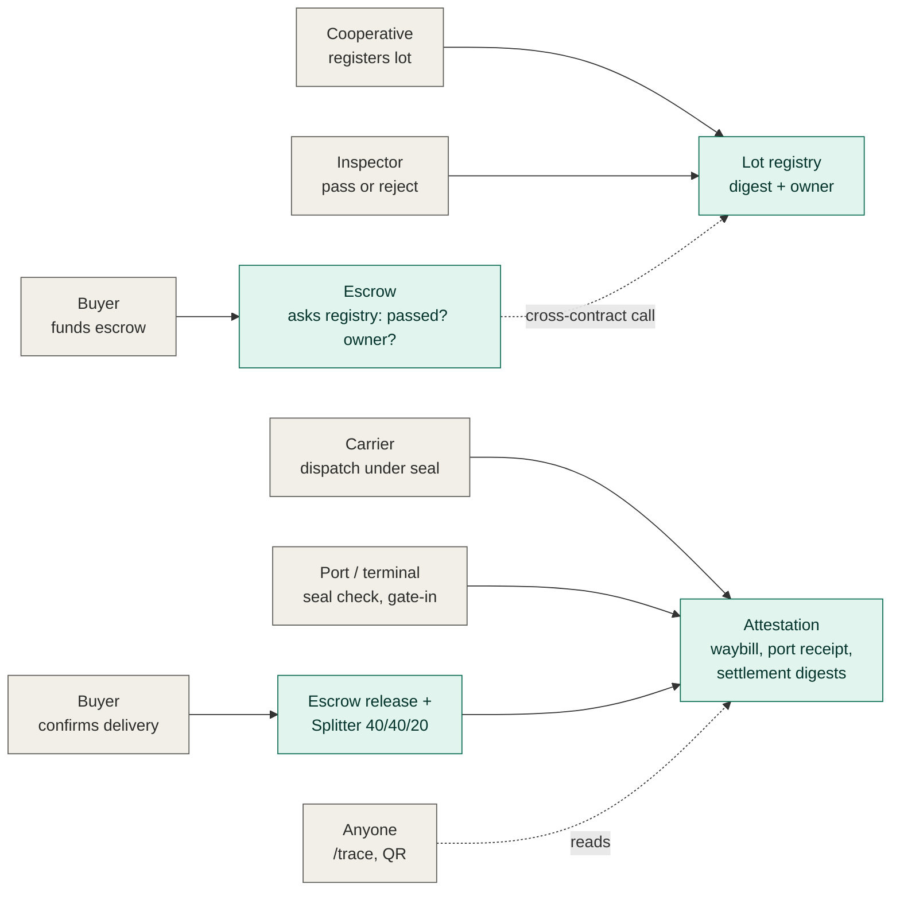

1. **Register.** The cooperative commits a SHA-256 digest of the lot record. Only the digest goes on-chain; the
   lot id is `sha256(cooperative, lot_ref)`, so no one can register a lot in another cooperative's name.
2. **Inspect.** An allow-listed inspector signs one pass or reject, with grade, measured quantity and moisture.
   A rejection needs a reason. A cooperative cannot inspect its own lot.
3. **Escrow.** The buyer funds the escrow. The contract asks the registry whether the lot passed and who owns it,
   so there is no payee argument and payment cannot be redirected. Uninspected lots are refused (error 10).
4. **Dispatch.** The carrier records the driver, vehicle and container seal; the waybill digest is attested.
5. **Gate-in.** The port or terminal enters the seal found on arrival. If it differs from the waybill, a tamper
   alert is raised and nothing is signed; otherwise the port receipt digest is attested.
6. **Settle and verify.** Confirming delivery releases the escrow, splits the payment 40/40/20 between the
   cooperative and its members (the remainder goes to the last share, so no unit is lost) and attests a settlement
   record that links every earlier digest. Anyone can check the full timeline at `/trace` with no login.

The dispatch and port attestations are currently signed by the AXK verifier key on the carrier's and port's behalf,
and the seal match is an application check rather than a contract rule. Self-signing by carriers and ports is
roadmap work (LOG-4, PORT-1). Full design: [docs/architecture.md](docs/architecture.md).

## How a lot is verified, step by step

This is the exact process the code runs, from the moment a lot is offered for sale to the moment the result
reaches everyone involved.

| Stage | Who | What is collected | What the system checks or decides | Who is told, and how |
|---|---|---|---|---|
| 1. Start: register the lot | Cooperative (`/trade/coop`) | Commodity, variety, declared grade, declared weight, origin, harvest date | Input is valid; the lot id is `sha256(cooperative, lot_ref)` so no one can register in another cooperative's name. The **agreed quality limits** for the lot are fixed now (table below) and included in the lot record | The lot record's SHA-256 digest is committed to the lot registry on Stellar. The lot appears in the inspector's queue and gets a QR code |
| 2. Assign an inspector | Allow-listed inspector | | Only an inspector on the registry's allow-list can sign; a cooperative can never inspect its own lot | |
| 3. Collect evidence | Inspector, on site (`/trade/inspect`) or offline in ODK Collect | Measured grade, measured weight (kg), moisture (%), sampling notes; for ODK, the original submission and its SHA-256 | The form refuses impossible values (weight above 0, moisture 0 to 40%) | |
| 4. Decide pass or reject | System and inspector | | The system compares each measurement with the lot's agreed limits and shows the result as the inspector types. **A pass is refused if any limit is broken**, before anything is signed. The inspector may still reject a lot that meets every limit, for defects the numbers do not capture, and must choose one of six listed reasons | |
| 5. Record the result | Inspector's key | | The inspection report (measurements, the limits, each check's result, verdict, reason) is hashed; the registry accepts **one** inspection per lot, ever | Status becomes Approved or Rejected; the transaction link is shown to the inspector |
| 6. Gate the payment | Escrow contract | | The escrow asks the registry two things: *did this lot pass?* and *who owns it?* An uninspected or rejected lot is refused (error 10); the payee cannot be chosen by anyone | Buyers only ever see passed lots, with the limits and every check result |
| 7. Communicate | Everyone | | | The cooperative and buyer screens show the checks; the public `/trace` page (no login, or scan the QR code) shows the verdict, the agreed limits, each check, the record digests and the transactions; a GS1 EPCIS 2.0 file can be downloaded |

After inspection, custody continues the same way: the carrier dispatches under a seal (waybill digest attested),
the port checks that the arriving seal matches the waybill (a mismatch raises a tamper alert and nothing is
signed), and the buyer's delivery confirmation releases the escrow, splits the payment and attests a settlement
record that links every earlier digest.

### The quality criteria

Each lot carries three limits, fixed at registration and covered by the lot's on-chain digest, so neither side
can change them later ([ledger/quality.py](frappe_app/axk_capstone/axk_capstone/ledger/quality.py)):

| Check | Rule | Reason given if it fails |
|---|---|---|
| Grade | Measured grade is the declared grade or better (A is best, C lowest) | Grade below declared |
| Weight | Measured weight is at least the declared weight less 2% | Weight below declared |
| Moisture | Measured moisture is at most the commodity's limit | Moisture above tolerance |

| Commodity | Maximum moisture |
|---|---|
| Coffee (parchment) | 12.0% |
| Maize (dry grain), Sorghum, Wheat | 13.5% |
| Beans (dry), Rice (paddy) | 14.0% |
| Cassava (dried chips) | 13.0% |
| Irish Potato | not checked (fresh produce is judged on defects and weight) |

These are configurable demonstration values in line with common East African trade practice. A real deployment
replaces them with the standard named in the sales contract. The other listed rejection reasons (foreign matter
or defects, pest or mould damage, documents missing or inconsistent) are the inspector's judgement and always
need a stated reason.

## How AXK differs from certification and inspection services

| Existing mechanism | What it proves | What it leaves open |
|---|---|---|
| Certification schemes (Fairtrade, Rainforest Alliance, organic) | A producer or process meets a standard, audited periodically | Nothing about the particular shipment being sold |
| Third-party pre-shipment inspection (SGS, Bureau Veritas, Intertek) | A specific lot was checked | A paper certificate, costly for small lots, with no link to payment |
| National standards bodies and export permits (RSB, KEBS, UNBS) | Goods meet the rules to cross a border | Protects the regulator, not the buyer-seller deal |
| **AXK** | **A specific lot met limits both sides agreed in advance** | |

The gap AXK fills is a lot-specific inspection result that cannot be altered, that anyone can check from a QR
code, and that controls the payment directly: escrow cannot release money for a lot that did not pass.

- **For the buyer:** pay only for a lot that met the agreed limits, and check that without trusting the seller.
- **For the seller:** the money is locked before the goods leave and is released on delivery; the public lot page
  is portable proof of quality for other buyers and lenders.

AXK complements these mechanisms rather than replacing them: a standards-body or inspection-company inspector can
be the allow-listed inspector, and a certificate number can be recorded in the lot.

## Screenshots

| | |
|---|---|
| 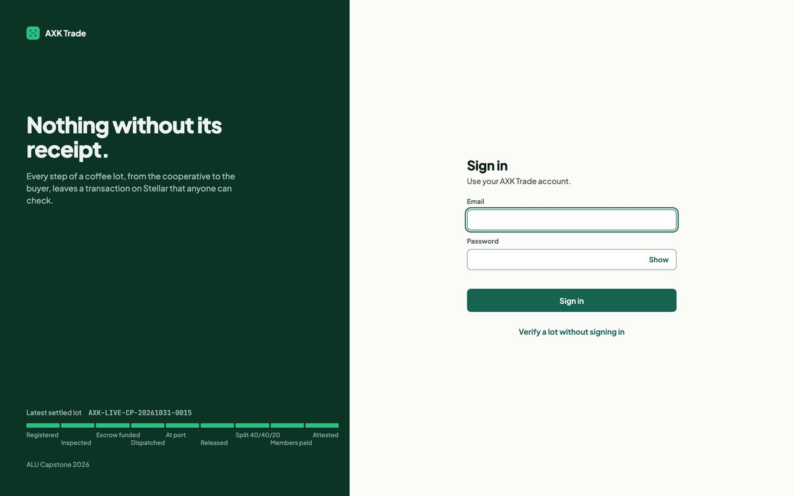 **Sign in.** One demo account per role; click a row, then sign in. | 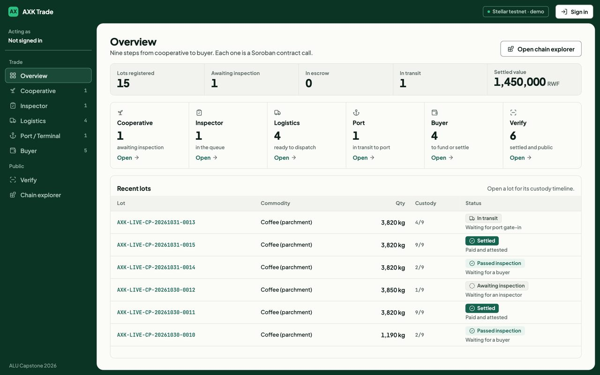 **Overview.** Work per role, recent lots and custody progress. |
| 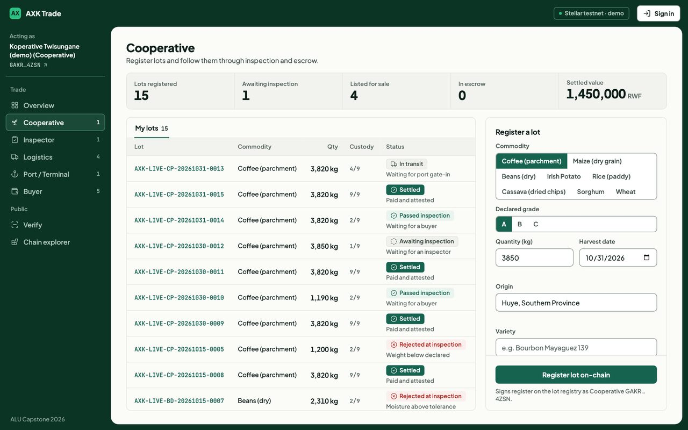 **Cooperative.** Register a lot and follow it to payment. | 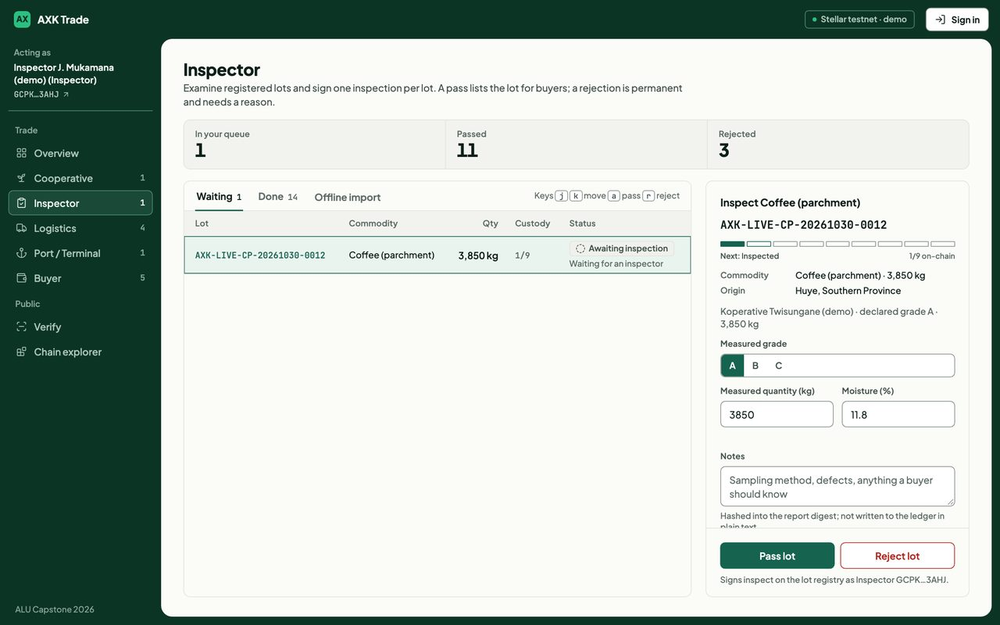 **Inspector.** Measured values, pass or reject with a reason, offline import. |
| 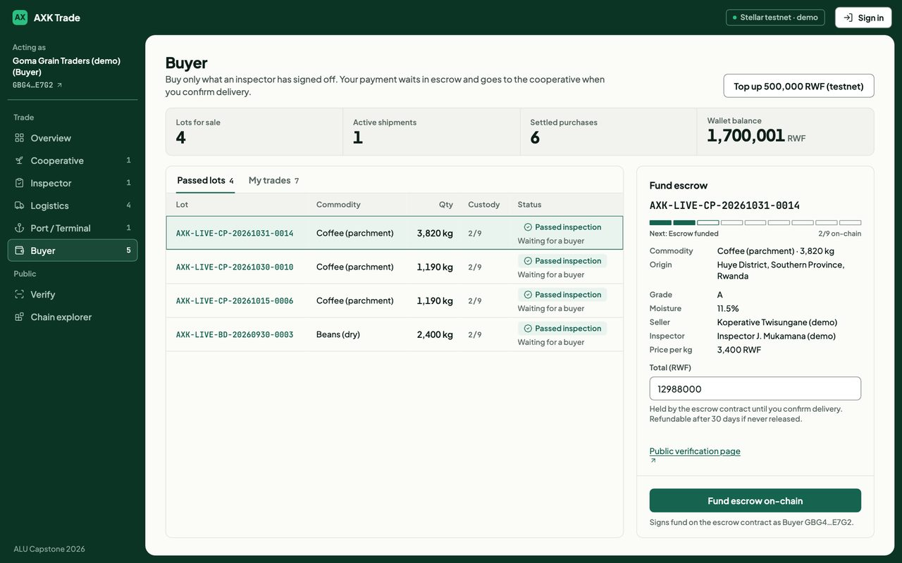 **Buyer.** Inspected lots only; fund escrow, confirm delivery. | 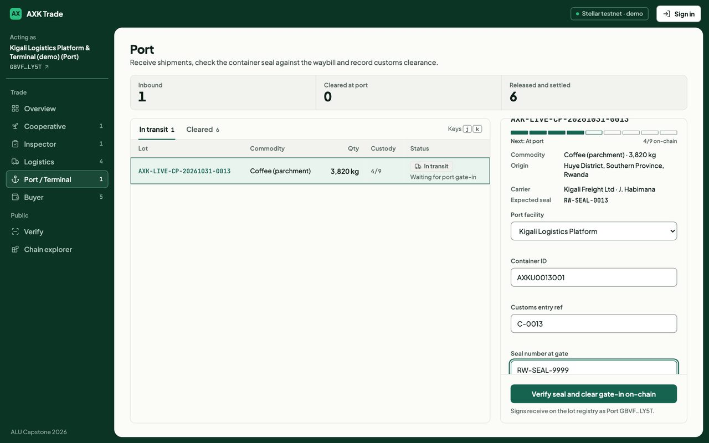 **Port / terminal.** Expected seal from the waybill, gate-in form. |
| 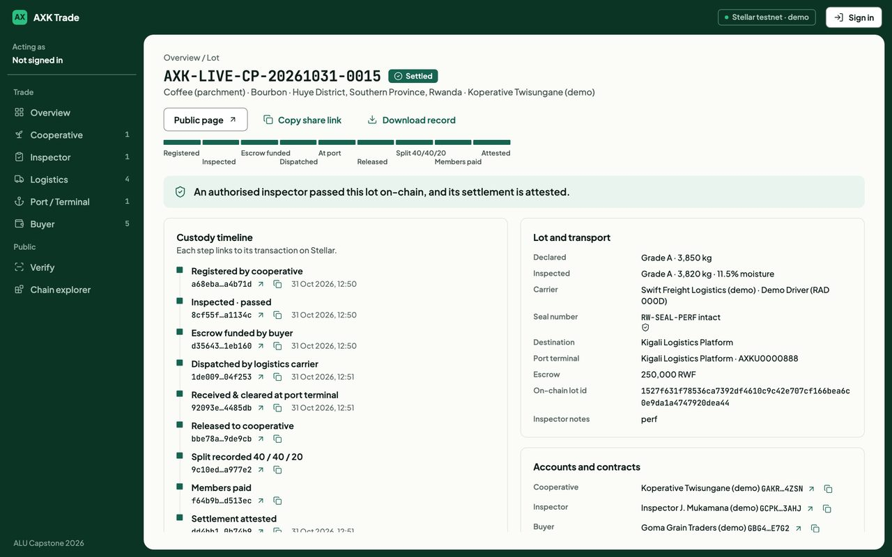 **Lot.** Nine-step custody strip; every notch is a real transaction. | 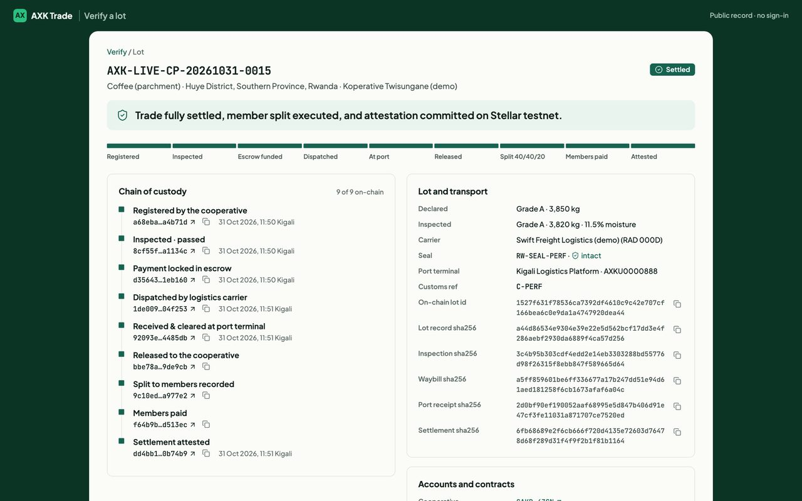 **Public trace.** Verdict, digests, QR code, EPCIS export; no login. No driver, inspector or buyer names; carrier, vehicle plate and customs details are shown. |
| 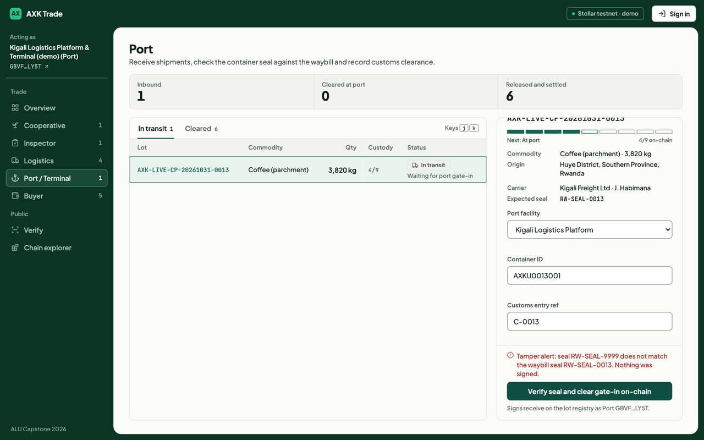 **Tamper alert.** A mismatched seal is refused and nothing is signed. | 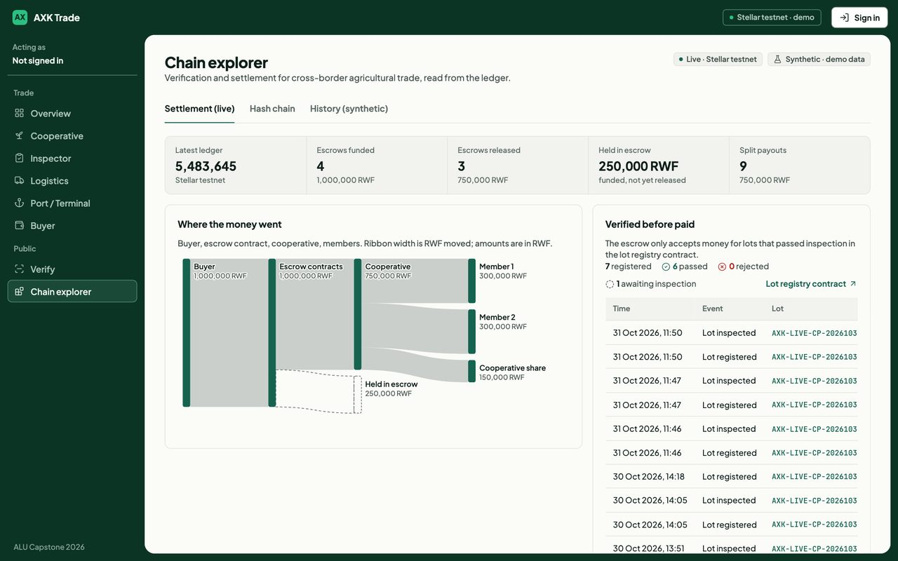 **Chain explorer.** Live testnet events and the flow of funds. |

<p align="center">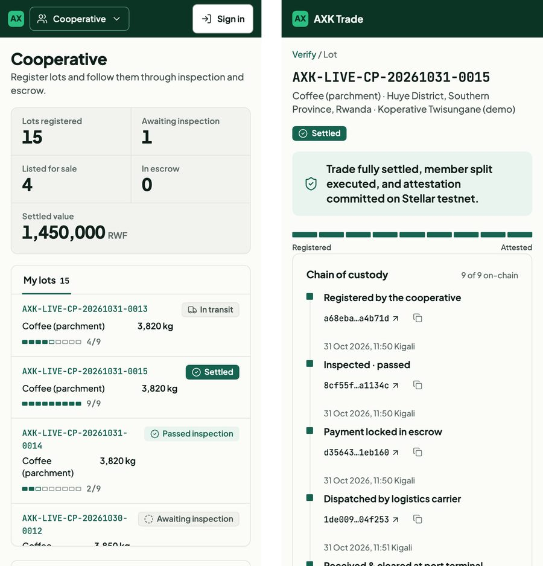<br><em>Phone layout (390 px): cooperative screen and public lot page.</em></p>

## Results

Measured on 30 and 31 October 2026 (test counts updated 27 November 2026). Raw outputs are in [docs/testing/](docs/testing/).

| Measure | Result |
|---|---|
| Automated tests | **180 passing** (65 contract, 32 ledger, 58 screens and logins, 8 EPCIS, 9 ODK, 8 end-to-end) |
| Trades on Stellar testnet | 15 lots: 6 settled, 3 rejected with a reason, 5 passed and awaiting a buyer, 1 awaiting inspection |
| Registration to settlement | 74 to 236 seconds per settled lot; every record matched its on-chain digest |
| One timed trade | 87.5 s end to end, of which settlement (4 transactions) 35.4 s |
| Browser compatibility | 80 of 80 page loads in Chromium, Firefox and WebKit at phone, tablet and desktop sizes, plus a slow-3G phone; no JavaScript errors, no sideways overflow |
| Page speed | Median 61 to 111 ms on a normal connection; slowest screen 3.8 s on the slow-3G phone (was 57.7 s before the lean page template) |
| API latency | 3 to 4 ms (overview, lot, EPCIS export) |
| Footprint | About 263 MB of memory for the whole stack at rest; main script 20 KB compressed; largest contract 7.4 KB |

## Features by role

| Role | Screen | What happens on-chain |
|---|---|---|
| Cooperative | `/trade/coop` | Registers a lot; the lot record's digest is committed to the **lot registry**, bound to the cooperative's address |
| Inspector | `/trade/inspect` | Signs one pass or reject with grade, quantity and moisture; rejections need a structured reason; imports inspections captured offline in ODK |
| Buyer | `/trade/buy` | Funds the **escrow** for a passed lot (balance checked first), later confirms delivery to trigger release, the **splitter** and the final **attestation** |
| Logistics | `/trade/logistics` | Records carrier, driver, vehicle and container seal; the waybill digest is attested |
| Port / Terminal | `/trade/port` | Checks the arriving seal against the waybill and records the customs reference; the port receipt digest is attested |
| Supervisor | all screens | Read and act across roles for review |
| Anyone | `/trace` | Looks up a lot by reference, hash or QR; re-checks the digests against the chain; downloads a GS1 EPCIS 2.0 document; no personal data |
| Anyone | `/chain` | Live testnet events, money flow and an in-browser hash-chain verifier; the five-year history view is labelled synthetic |

## Architecture

```
Browser (role screens, /trace, /chain)        ODK Collect (offline inspection)
              |                                          |
              v                                          v
Frappe v15 app: trade_api.py (role guard, rate limit), verify.py, epcis.py, odk.py
              |
              v
ledger/ package (no Frappe import)
  records.py    canonical JSON + SHA-256 (LotRecord, InspectionReport, Waybill, PortReceipt, SettlementRecord)
  contracts.py  one client class per contract, typed error tables, CommandRunner (stellar-cli or a test fake)
  workflow.py   TradeWorkflow: state machine, balance check, resumable settlement
              |                                   |
              v                                   v
MariaDB 10.11 + Redis                    Stellar testnet (Soroban)
(full records, tx hashes)                lot registry <- escrow (cross-contract), splitter, attestation, RWF test token
```

Keys are held server-side, one Stellar identity per role, and never reach the browser. Trade data stays in the
database; only digests, statuses and addresses go on-chain. Diagrams, sequences and the data model are in
[docs/architecture.md](docs/architecture.md); the 14 contract guarantees and the test that pins each are in
[docs/security.md](docs/security.md).

## Technical requirements

Versions this release was built and tested with. Newer patch versions should work.

| Component | Version | Used for |
|---|---|---|
| Rust | 1.98 (stable), target `wasm32v1-none` | Smart contracts |
| soroban-sdk | 22.0.11 | Contract framework |
| stellar-cli | 28.0.0 | Building, deploying and signing |
| Stellar network | testnet (Soroban RPC + Horizon) | Contracts and the RWF test token (Stellar Asset Contract) |
| Python | 3.11 | Frappe app, scripts and tests |
| Frappe framework / bench | 15.104.0 / 5.31.0 | Application server, roles, REST API, web pages (ERPNext not required) |
| MariaDB | 10.11 | Application database |
| Redis | 7 or later (tested 8.10) | Cache and job queue |
| Node.js | 18 or later (tested 24) | Frappe asset build |
| Python packages | stellar-sdk 13.2, qrcode 8.2 | Chain reads, QR codes |
| Frontend | HTML, CSS, vanilla JavaScript, WebCrypto; self-hosted fonts; no framework | Role screens and public pages |
| Browsers | Current Chrome, Edge, Firefox and Safari | Tested at phone, tablet and desktop sizes |
| Operating system | macOS 15 (Apple silicon) and Ubuntu 24.04 (hosted) | |
| Hardware | 2 CPU cores, 4 GB RAM, 5 GB disk minimum | |

The offline simulation needs only Python 3.10 or later.

## Getting started

There are two ways to run AXK. Only the full stack touches the blockchain.

| | Offline simulation | Full stack (use this to evaluate) |
|---|---|---|
| Command | `make run` | `make run-frappe` |
| Blockchain | None; hashes are computed locally and labelled *simulated* | Every action is a real Stellar testnet transaction |
| Needs | Python 3.10 or later, nothing else | Frappe v15 bench, MariaDB 10.11, Redis, Node 18+, Rust, stellar-cli |
| Time to set up | 2 minutes | About 45 minutes the first time |
| Good for | A quick look at every screen; UI contributions | The real system; anything touching contracts or the ledger |

If you only want to see it working, use the hosted system at **https://capstone.axk.org/login** (one-click demo
logins) and skip installation entirely.

### Option A: offline simulation (2 minutes)

```bash
git clone https://github.com/tejirijesse/axk-open-source-capstone.git
cd axk-open-source-capstone
python3 --version            # must be 3.10 or later
make run                     # or: python3 scripts/server.py
```

Open http://localhost:8000/trade. The same screens, the same quality rule and seeded sample lots; nothing is
signed, and every page says so. Stop it with Ctrl+C. To start from fresh sample data, delete `scripts/axk.db`.

### Option B: full stack on Stellar testnet

Every command below is meant to be run in order. Tested on macOS 15 (Apple silicon) and Ubuntu 24.04.

#### 1. Install the system packages

macOS (Homebrew):

```bash
brew install git python@3.11 pipx mariadb@10.11 redis node@18 rustup stellar-cli
brew services start mariadb@10.11
brew services start redis
npm install -g yarn
rustup default stable
rustup target add wasm32v1-none
```

Ubuntu 24.04:

```bash
sudo apt update
sudo apt install -y git python3-dev python3-venv python3-pip pipx mariadb-server mariadb-client \
  redis-server libmariadb-dev pkg-config build-essential curl
curl -fsSL https://deb.nodesource.com/setup_18.x | sudo -E bash - && sudo apt install -y nodejs
sudo npm install -g yarn
curl --proto '=https' --tlsv1.2 -sSf https://sh.rustup.rs | sh -s -- -y && source "$HOME/.cargo/env"
rustup target add wasm32v1-none
cargo install --locked stellar-cli@28.0.0
```

Check: `python3 --version` (3.10 or later; 3.11 is the tested version), `node --version` (18 or later),
`stellar --version` (28.x), `cargo --version`.

#### 2. Configure MariaDB for Frappe

Frappe needs the utf8mb4 character set. Add this to the MariaDB configuration (macOS:
`/opt/homebrew/etc/my.cnf`; Ubuntu: `/etc/mysql/my.cnf`), then restart MariaDB
(`brew services restart mariadb@10.11` or `sudo systemctl restart mariadb`):

```ini
[mysqld]
character-set-client-handshake = FALSE
character-set-server = utf8mb4
collation-server = utf8mb4_unicode_ci

[mysql]
default-character-set = utf8mb4
```

Give the MariaDB root user a password if it has none (`sudo mariadb-secure-installation` on Ubuntu;
`mariadb -u root` then `ALTER USER 'root'@'localhost' IDENTIFIED BY '<password>';` on macOS). Bench asks for it
once, when it creates the site.

#### 3. Clone the repository and build the contracts

```bash
git clone https://github.com/tejirijesse/axk-open-source-capstone.git
cd axk-open-source-capstone
make test-contracts     # 65 contract tests
make build              # four contracts to wasm
make demo               # creates funded testnet accounts, deploys fresh contracts and runs one verified trade
```

`make demo` creates the stellar-cli identities `axk-coop`, `axk-inspector`, `axk-buyer`, `axk-verifier`, and
the others, funds them from the testnet friendbot, deploys the lot registry, escrow, splitter and attestation
contracts, issues a 250,000 RWF test balance to the buyer and prints a transaction link for every step. The
contract ids are saved in `scripts/.demo-state.env` (not committed). It needs an internet connection and takes
2 to 4 minutes.

#### 4. Create a Frappe bench next to the repository

The Makefile expects the bench at `../axk-bench` (beside the repository folder). To put it elsewhere, add
`BENCH=/path/to/axk-bench` to every `make` command below.

```bash
cd ..
pipx install frappe-bench            # provides the `bench` command (version 5.x); then open a new terminal
bench init axk-bench --frappe-branch version-15
cd axk-bench
bench new-site axk.localhost         # asks for the MariaDB root password and a new Administrator password
bench use axk.localhost
cd ../axk-open-source-capstone
```

#### 5. Install the app and point it at your contracts

```bash
make install-app          # links frappe_app/axk_capstone into the bench, installs it, builds its assets
make contracts-config     # writes the contract ids from step 3 into the site config
cd ../axk-bench
bench --site axk.localhost set-config axk_demo_mode 1                       # local development only
bench --site axk.localhost set-config axk_demo_password '<8+ characters>'  # optional: one demo login per role
bench --site axk.localhost migrate
cd ../axk-open-source-capstone
```

Demo mode lets the screens sign without logging in, **only for requests made directly on your own machine**;
anything arriving through a proxy or tunnel is refused. Turn it off on any shared host.

#### 6. Run it

```bash
make run-frappe           # web server, workers and assets; leave this terminal open
```

In a second terminal:

```bash
make check-env            # every line should be a green tick, ending "Environment ready."
```

Open http://localhost:8000/trade (Safari does not resolve `*.localhost`; use `localhost`, as here). Stop the
server with Ctrl+C in its terminal.

#### 7. Walk one lot through the system

1. **Cooperative** (`/trade/coop`): register a Coffee lot of 1,000 kg, grade A. Note the agreed limits shown
   for it: grade A or better, at least 980 kg, moisture at most 12%.
2. **Inspector** (`/trade/inspect`): select the lot. Type a moisture of 13.2%: the checklist turns red and
   *Pass lot* is disabled. Change it to 11.5% and pass the lot. A transaction link appears.
3. **Buyer** (`/trade/buy`): the lot is now listed with its check results. Fund the escrow.
4. **Logistics** (`/trade/logistics`): dispatch with a seal number. **Port** (`/trade/port`): enter the same seal
   (a different seal raises a tamper alert).
5. **Buyer**: confirm delivery. The escrow releases, the payment is split 40/40/20 and the settlement is attested.
6. **Anyone** (`/trace`): look up the lot or scan its QR code. All nine custody steps show a real transaction.

`make show-db` prints the five newest trades as stored in MariaDB, with their transaction hashes.

### Pages

| Page | URL |
|---|---|
| Sign in | `/login` |
| Overview | `/trade` |
| Cooperative, Inspector, Buyer | `/trade/coop`, `/trade/inspect`, `/trade/buy` |
| Logistics, Port / Terminal | `/trade/logistics`, `/trade/port` |
| Lot detail | `/trade/lot?name=<lot>` |
| Public verification (no login) | `/trace`, `/trace/lot?ref=<lot>` |
| Chain explorer | `/chain` |
| Privacy policy | `/privacy` |

## Troubleshooting

| Symptom | Cause and fix |
|---|---|
| `make run-frappe` says *already running* | Another copy is running. Stop it with Ctrl+C in its terminal, or `pkill -f 'honcho start'`, then start again |
| *Address already in use* on port 8000 | Something else uses the port: `lsof -iTCP:8000 -sTCP:LISTEN` shows what |
| `make check-env` shows a red MariaDB or Redis line | Start them: `brew services start mariadb@10.11 redis` (macOS) or `sudo systemctl start mariadb redis-server` (Ubuntu) |
| *axk_stellar site config is missing ...* | Run `make demo` then `make contracts-config` (step 3 and 5) |
| *Too many transactions this hour* | Each user may sign 30 transactions an hour. Wait, or on your own machine clear the counter: `redis-cli -p 13000 --scan --pattern '*axk_capstone:signs*' \| xargs redis-cli -p 13000 del` |
| *The buyer holds ... RWF, less than ...* | The buyer's test balance is spent. Run `make demo` again (new contracts and a fresh 250,000 RWF), then `make contracts-config` |
| *cannot pass: moisture ... is above the ...% limit* | Working as designed: the measurement breaks the lot's agreed limits. Reject the lot with the suggested reason, or correct the measurement |
| Contract calls fail after weeks of working | Stellar testnet is reset from time to time, which deletes accounts and contracts. Run `make demo` and `make contracts-config` again |
| Pages look unstyled | Rebuild assets: `cd ../axk-bench && bench build --app axk_capstone` |
| `bench new-site` fails on character set | Step 2 was skipped or MariaDB was not restarted |

## Testing

```bash
make test               # contracts, ledger, screens and logins, EPCIS, ODK, then end-to-end (needs a server on :8000)
```

The end-to-end suite is written for the offline simulation, so run it against `make run`. Its quality test
(`test_08`) also passes against the full stack, on testnet:

```bash
make run                # terminal 1: offline simulation
make test-python        # terminal 2: all 8 end-to-end tests

# against the full stack (make run-frappe running): the quality test, on testnet
python3 scripts/test_trade.py TestAXKEndToEnd.test_08_quality_criteria_refuse_a_pass_outside_the_limits
```

| Suite | Tests | What it checks | Command |
|---|---|---|---|
| Smart contracts | 65 | Lot registry 18, escrow 27, splitter 12, attestation 8: write-once records, allow-listed inspectors, inspection gate, fixed payee, refund deadline, lossless split, typed errors | `make test-contracts` |
| Ledger object model | 32 | Digest format unchanged, error tables, state machine refusals, resumable settlement, seal check, buyer balance check, quality criteria: limits per lot, each failed check names its reason, a pass outside the limits is refused before signing (stellar-cli replaced by a fake) | `make test-ledger` |
| Custody strip and demo logins | 58 | Strip state from real hashes only (15), demo accounts, access blocks and open-redirect check (40), lot transaction fields (3) | `make test-custody test-demo` |
| GS1 EPCIS export | 8 | EPCIS 2.0 structure, official JSON schema, no private fields | `make test-epcis` |
| ODK offline inspection | 9 | Form, importer, ODK Central sync; one live test needs `AXK_ODK_LIVE=1` | `make test-odk` |
| End-to-end | 8 | Full lifecycle, inspection rejection, seal tampering, invalid transitions, unknown lot, routes, quality limits refuse a pass | `make test-python` |
| **Total** | **180** | | `make test` |
| Compatibility | 80 page loads | 3 browser engines x phone, tablet, desktop + slow-3G phone | `python3 scripts/test_compat.py` |
| Performance | | Response times, timed testnet trade, memory, sizes | `AXK_PERF_TX=1 python3 scripts/measure_performance.py` |

Contract errors observed on testnet, with transaction links, are recorded in [docs/deployments.md](docs/deployments.md).

## Repository layout

```
contracts/                      Soroban workspace: lot_registry, escrow, splitter, attestation (65 tests)
frappe_app/axk_capstone/axk_capstone/
  ledger/                       records.py, contracts.py, workflow.py (object model, no Frappe import)
  chain.py                      wires Frappe config, cache and clock into the ledger classes
  trade_api.py                  role endpoints, access guard, rate limit
  custody.py                    custody strip state (a step counts only with a real tx hash)
  demo.py, setup.py             demo logins per role, landing pages, account protections
  verify.py, epcis.py, odk.py   public lookup, GS1 EPCIS export, offline inspection import
  stellar_live.py               Soroban RPC event reader for the explorer
  www/                          /login, /trade/*, /trace/*, /chain pages
  public/, templates/           CSS, JavaScript, fonts, icons, page templates
odk/                            ODK inspection form and ODK Central sync
axk_seed/                       synthetic five-year dataset and importer (labelled synthetic everywhere)
scripts/                        demo.sh, run-frappe.sh, server.py (offline simulation), all test suites,
                                test_compat.py, measure_performance.py
docs/                           architecture, security, deployments, handover, design system, technical report,
                                testing results, screenshots
api/, vercel.json               offline simulation on Vercel
ROADMAP.md, CONTRIBUTING.md     contribution tracks and project rules
Makefile                        one command per task (`make help`)
```

## Deployment

| Stage | Where | What changes |
|---|---|---|
| Local | Frappe bench on a laptop, Stellar testnet | Demo mode on loopback only; keys in the stellar-cli keystore |
| **Hosted (now)** | https://capstone.axk.org: Ubuntu 24.04, nginx + TLS, supervisor, Frappe v15, MariaDB 10.11, Redis, Stellar testnet | Demo mode off; signing needs a login with the AXK Capstone Demo role; 30 transactions per user per hour; keys readable only by the service user, outside git. Operation: [docs/handover.md](docs/handover.md) |
| Pilot (3 months, Kigali) | One VM, HTTPS, Stellar testnet | One account per participant; managed key store; nightly backups; an event indexer so history outlives the RPC's 7-day window; 30 to 50 traders and one cooperative |
| Production | Managed VM per tenant, Stellar mainnet | External contract audit first; admin, verifier, coordinator and attester as four separately held keys; regulated stablecoin instead of the test token; mobile-money cash-out through a SEP-24 anchor; monitoring |

**Deploying a release**

```bash
# contracts (per network)
make build
stellar contract deploy --wasm contracts/target/wasm32v1-none/release/axk_lot_registry.wasm \
  --source <admin> --network <net> -- --admin <admin-address>
stellar contract deploy --wasm contracts/target/wasm32v1-none/release/axk_escrow.wasm \
  --source <verifier> --network <net> -- --verifier <verifier-address> --registry <registry-id>
# splitter (--coordinator) and attestation (--attester) the same way, then add_inspector for each inspector

# application
git pull                                          # in the app checkout on the server
bench --site <site> migrate
bench build --app axk_capstone
bench --site <site> set-config --parse axk_stellar '{"network":"<net>","registry":"...","escrow":"...","splitter":"...","attestation":"...","token":"..."}'
bench --site <site> set-config axk_demo_mode 0
sudo supervisorctl restart all                    # or: bench restart
```

Contracts are immutable once deployed: a new version means new contract ids and a config change, and trades
already open on the old escrow finish there. Roll the application back with `git checkout <previous-tag>`,
then `bench --site <site> migrate && bench build`.

## Security and data honesty

- **Testnet only.** No real money moves. The RWF token is a Stellar test asset.
- **Keys never reach the browser.** One identity per role, stored server-side with permissions for the service
  user only, never committed. Custodial signing is a known limit; participant self-signing is on the roadmap.
- **No false state.** If a chain call fails, the step fails, the database change is rolled back and the reason is
  shown; a lot never claims a step the ledger did not accept. Custody notches fill only for a valid transaction hash.
- **Synthetic data is labelled.** The five-year history on `/chain` (646 lots, 5,258 events) is synthetic seed
  data, tagged `axk_synthetic_seed = 1` and labelled on every screen. It is not pilot evidence. The offline
  simulation is labelled *Offline simulation, not on-chain* and never links to a block explorer.
- **Report issues privately:** see [SECURITY.md](SECURITY.md).

## Documentation

| Topic | Document |
|---|---|
| Capstone final report (PDF, 73 pages; Word version) | [docs/final/AXK-Capstone-Final-Report.pdf](docs/final/AXK-Capstone-Final-Report.pdf) • [.docx](docs/final/AXK-Capstone-Final-Report.docx) |
| Ethics in Practice: risks, laws, IP and REC approval (PDF) | [docs/final/AXK-Ethics-in-Practice.pdf](docs/final/AXK-Ethics-in-Practice.pdf) |
| Technical report (PDF, 5 pages) | [docs/AXK-Capstone-Technical-Report.pdf](docs/AXK-Capstone-Technical-Report.pdf) |
| Technical report (HTML interactive view) | [docs/technical-report.html](docs/technical-report.html) |
| Demo video walkthrough (1080p MP4) | [docs/demo/axk-capstone-demo.mp4](docs/demo/axk-capstone-demo.mp4) |
| Demo video script and narrative | [docs/demo-video-script.md](docs/demo-video-script.md) |
| System schematic, sequences, state machines, data model | [docs/architecture.md](docs/architecture.md) |
| Roles, 14 contract guarantees, application controls, known limits | [docs/security.md](docs/security.md) |
| Contract reference and design rationale | [contracts/README.md](contracts/README.md) |
| Testnet deployments and errors observed on-chain | [docs/deployments.md](docs/deployments.md) |
| Hosted deployment: deploy, restart, keys, health check | [docs/handover.md](docs/handover.md) |
| Design system ("nothing without its receipt") | [docs/design/DESIGN_SYSTEM.md](docs/design/DESIGN_SYSTEM.md) |
| GS1 EPCIS 2.0 export | [docs/epcis.md](docs/epcis.md) |
| Offline inspection with ODK | [odk/README.md](odk/README.md) |
| Mobile-money payout design (Mojaloop) | [docs/design/set-3-mojaloop-payouts.md](docs/design/set-3-mojaloop-payouts.md) |
| Synthetic history dataset | [docs/history-dataset.md](docs/history-dataset.md) |
| Open standards and projects AXK learns from | [docs/references.md](docs/references.md) |
| Compatibility and performance results | [docs/testing/](docs/testing/) |

## Contributing

AXK is open source and built to be extended one step at a time. Every stage of the trade (cooperative, inspector,
buyer, logistics, port, settlement, public trace) has a track in [ROADMAP.md](ROADMAP.md), from starter tasks such
as translations and a refund button to contract work such as disputes, two-party custody handoffs and quorum
inspection.

- [CONTRIBUTING.md](CONTRIBUTING.md): setup, workflow, tests and the rules that are not negotiable (data honesty,
  no secrets, testnet only)
- [CODE_OF_CONDUCT.md](CODE_OF_CONDUCT.md), [SECURITY.md](SECURITY.md), [GOVERNANCE.md](GOVERNANCE.md),
  [CHANGELOG.md](CHANGELOG.md)

## Provenance

The escrow, splitter and attestation contracts originate in AXK Network, the author's venture
(`AXKNETWORK/axk-stellar`, MIT). In this capstone the escrow was rebuilt around the new lot registry (inspection
gate, payee from the registry, one live escrow per lot). The lot registry, the Frappe app, the ledger package, the
demo script and the explorer were written for this capstone.

## License

MIT. Copyright (c) 2026 AFRIKABAL Inc. See [LICENSE](LICENSE).
