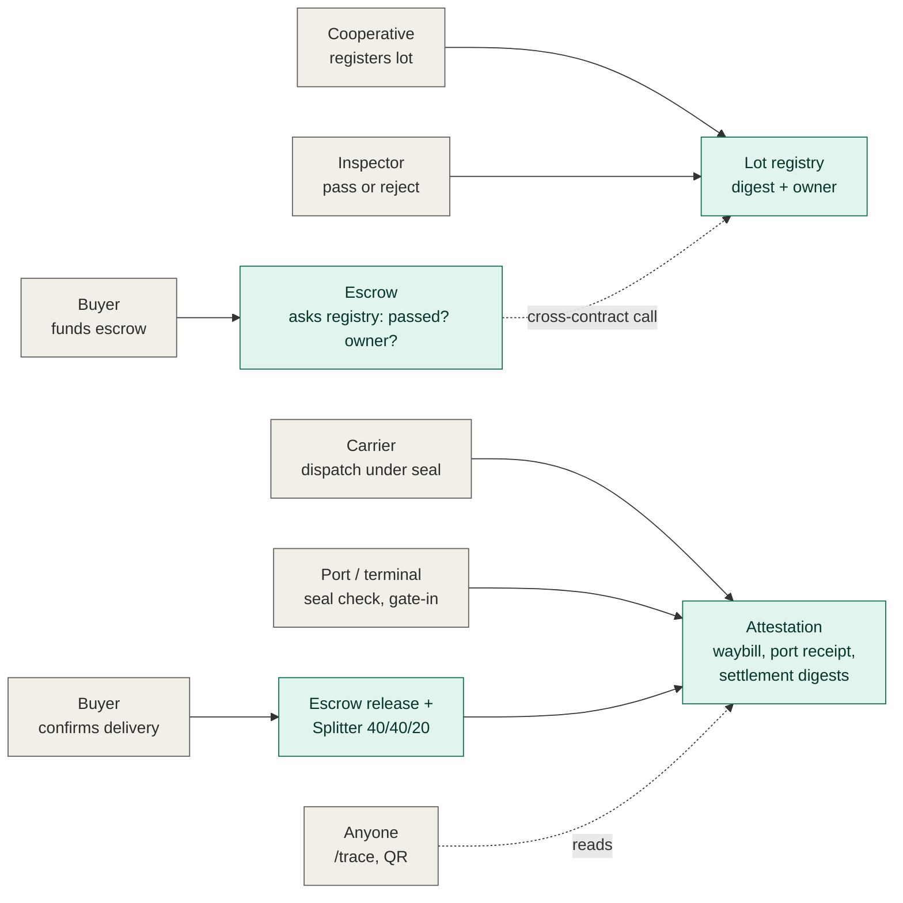
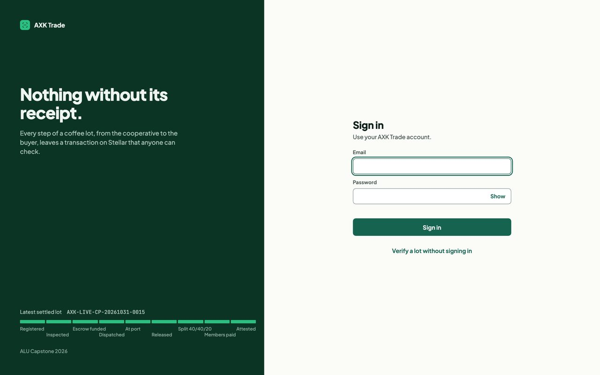
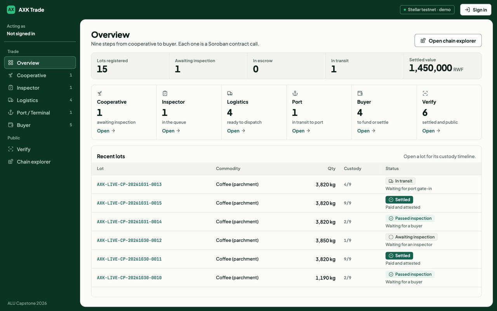
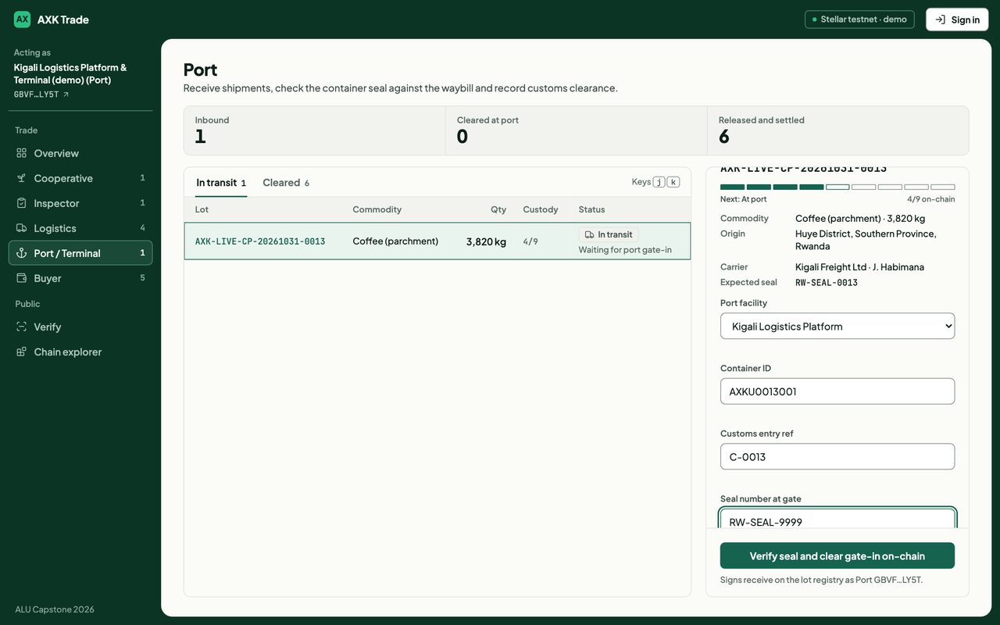
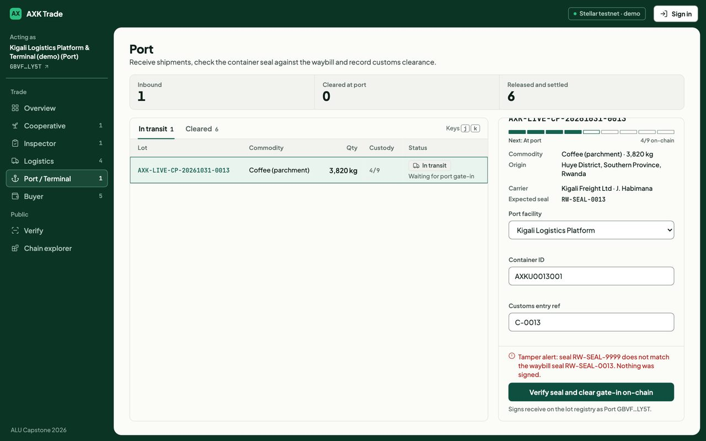
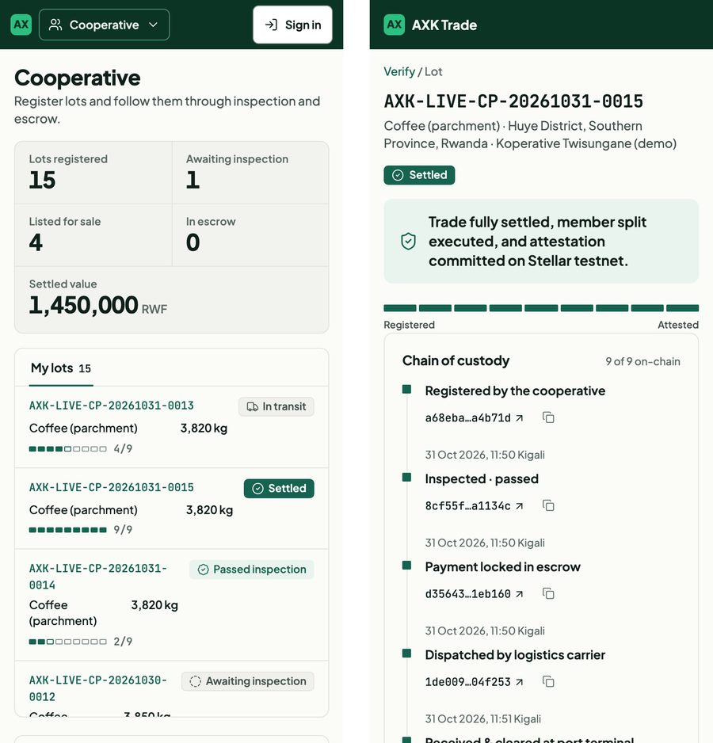

# AXK Network: Verification and Settlement Layer

**Verified cross-border agricultural trade, settled on Stellar.**
Capstone project, BSE Software Engineering (Low-Level / Blockchain track), African Leadership University, 2026.
Oghenetejiri Jesse. Supervisor: Junior Turatsinze.


-0c3424)

Cross-border agricultural trade in East Africa breaks at two points. A buyer cannot verify a lot's quality,
quantity and custody across the corridor, and payment is slow, costly and hard to trust, so whoever pays or ships
first carries all the risk. AXK puts verification and settlement in one workflow: an independent inspection decides
whether payment can move, every custody step is a signed transaction on Stellar, and anyone can check the record
from a QR code.

| | |
|---|---|
| **Live system** | https://capstone.axk.org (full stack on Stellar testnet, one-click demo logins) |
| **Demo video (1080p)** | [docs/demo/axk-capstone-demo.mp4](docs/demo/axk-capstone-demo.mp4) (watch in repo / download, 3:34) • [YouTube mirror](https://youtu.be/MrSXiJG_MAU) |
| **Technical report** | [docs/AXK-Capstone-Technical-Report.pdf](docs/AXK-Capstone-Technical-Report.pdf) (5 pages, PDF) • [HTML online report](docs/technical-report.html) |
| **Submission archive** | [TJ's capstone.zip (Google Drive)](https://drive.google.com/file/d/1q7GMFwB5EmQyrwfB6LSTES91j8XYVlfK/view?usp=sharing) (full bundle: code, report & video) |
| **Verified live lot** | [AXK-LIVE-CP-20261031-0005](https://capstone.axk.org/trace/lot?ref=AXK-LIVE-CP-20261031-0005) (all 9 custody steps settled on Stellar) |
| **Chain explorer** | https://capstone.axk.org/chain (live token flow across all lots) |
| **Try without installing** | https://axk-open-source-capstone.vercel.app (offline simulation, nothing on-chain) |
| **Source** | https://github.com/tejirijesse/axk-open-source-capstone (MIT) |

---

## Contents

- [Try it in two minutes](#try-it-in-two-minutes)
- [How it works](#how-it-works)
- [Screenshots](#screenshots)
- [Results](#results)
- [Features by role](#features-by-role)
- [Architecture](#architecture)
- [Technical requirements](#technical-requirements)
- [Getting started](#getting-started)
- [Testing](#testing)
- [Repository layout](#repository-layout)
- [Deployment](#deployment)
- [Security and data honesty](#security-and-data-honesty)
- [Documentation](#documentation)
- [Contributing](#contributing)

---

## Try it in two minutes

1. Open **https://capstone.axk.org/login**. The sign-in page lists one demo account per role.
2. Click the **Cooperative** row. The email and password fill in. Click **Sign in**.
3. Register a lot. Sign out, then sign in as **Inspector** and pass it, as **Buyer** and fund the escrow, as
   **Logistics** and dispatch it under a seal, as **Port / Terminal** and gate it in, and finally as **Buyer** to
   confirm delivery. Each step returns a transaction link to the Stellar Expert explorer.
4. Open the lot's public page (**Verify**, or `/trace`) without signing in. The custody strip shows nine steps,
   each backed by a real transaction hash, with a QR code and a GS1 EPCIS export.

The **Supervisor** account sees every screen. Demo accounts cannot change the shared password, rename themselves
or share records, and each user is limited to 30 signed transactions per hour.

## How it works



1. **Register.** The cooperative commits a SHA-256 digest of the lot record. Only the digest goes on-chain; the
   lot id is `sha256(cooperative, lot_ref)`, so no one can register a lot in another cooperative's name.
2. **Inspect.** An allow-listed inspector signs one pass or reject, with grade, measured quantity and moisture.
   A rejection needs a reason. A cooperative cannot inspect its own lot.
3. **Escrow.** The buyer funds the escrow. The contract asks the registry whether the lot passed and who owns it,
   so there is no payee argument and payment cannot be redirected. Uninspected lots are refused (error 10).
4. **Dispatch.** The carrier records the driver, vehicle and container seal; the waybill digest is attested.
5. **Gate-in.** The port or terminal enters the seal found on arrival. If it differs from the waybill, a tamper
   alert is raised and nothing is signed; otherwise the port receipt digest is attested.
6. **Settle and verify.** Confirming delivery releases the escrow, splits the payment 40/40/20 between the
   cooperative and its members (the remainder goes to the last share, so no unit is lost) and attests a settlement
   record that links every earlier digest. Anyone can check the full timeline at `/trace` with no login.

The dispatch and port attestations are currently signed by the AXK verifier key on the carrier's and port's behalf,
and the seal match is an application check rather than a contract rule. Self-signing by carriers and ports is
roadmap work (LOG-4, PORT-1). Full design: [docs/architecture.md](docs/architecture.md).

## Screenshots

| | |
|---|---|
|  **Sign in.** One demo account per role; click a row, then sign in. |  **Overview.** Work per role, recent lots and custody progress. |
|  **Cooperative.** Register a lot and follow it to payment. |  **Inspector.** Measured values, pass or reject with a reason, offline import. |
|  **Buyer.** Inspected lots only; fund escrow, confirm delivery. |  **Port / terminal.** Expected seal from the waybill, gate-in form. |
|  **Lot.** Nine-step custody strip; every notch is a real transaction. |  **Public trace.** Verdict, digests, QR code, EPCIS export; no login, no personal data. |
|  **Tamper alert.** A mismatched seal is refused and nothing is signed. |  **Chain explorer.** Live testnet events and the flow of funds. |

<p align="center"><br><em>Phone layout (390 px): cooperative screen and public lot page.</em></p>

## Results

Measured on 30 and 31 October 2026. Raw outputs are in [docs/testing/](docs/testing/).

| Measure | Result |
|---|---|
| Automated tests | **169 passing** (65 contract, 22 ledger, 58 screens and logins, 8 EPCIS, 9 ODK, 7 end-to-end) |
| Trades on Stellar testnet | 15 lots: 6 settled, 3 rejected with a reason, 5 passed and awaiting a buyer, 1 awaiting inspection |
| Registration to settlement | 74 to 236 seconds per settled lot; every record matched its on-chain digest |
| One timed trade | 87.5 s end to end, of which settlement (4 transactions) 35.4 s |
| Browser compatibility | 80 of 80 page loads in Chromium, Firefox and WebKit at phone, tablet and desktop sizes, plus a slow-3G phone; no JavaScript errors, no sideways overflow |
| Page speed | Median 61 to 111 ms on a normal connection; slowest screen 3.8 s on the slow-3G phone (was 57.7 s before the lean page template) |
| API latency | 3 to 4 ms (overview, lot, EPCIS export) |
| Footprint | About 263 MB of memory for the whole stack at rest; main script 20 KB compressed; largest contract 7.4 KB |

## Features by role

| Role | Screen | What happens on-chain |
|---|---|---|
| Cooperative | `/trade/coop` | Registers a lot; the lot record's digest is committed to the **lot registry**, bound to the cooperative's address |
| Inspector | `/trade/inspect` | Signs one pass or reject with grade, quantity and moisture; rejections need a structured reason; imports inspections captured offline in ODK |
| Buyer | `/trade/buy` | Funds the **escrow** for a passed lot (balance checked first), later confirms delivery to trigger release, the **splitter** and the final **attestation** |
| Logistics | `/trade/logistics` | Records carrier, driver, vehicle and container seal; the waybill digest is attested |
| Port / Terminal | `/trade/port` | Checks the arriving seal against the waybill and records the customs reference; the port receipt digest is attested |
| Supervisor | all screens | Read and act across roles for review |
| Anyone | `/trace` | Looks up a lot by reference, hash or QR; re-checks the digests against the chain; downloads a GS1 EPCIS 2.0 document; no personal data |
| Anyone | `/chain` | Live testnet events, money flow and an in-browser hash-chain verifier; the five-year history view is labelled synthetic |

## Architecture

```
Browser (role screens, /trace, /chain)        ODK Collect (offline inspection)
              |                                          |
              v                                          v
Frappe v15 app: trade_api.py (role guard, rate limit), verify.py, epcis.py, odk.py
              |
              v
ledger/ package (no Frappe import)
  records.py    canonical JSON + SHA-256 (LotRecord, InspectionReport, Waybill, PortReceipt, SettlementRecord)
  contracts.py  one client class per contract, typed error tables, CommandRunner (stellar-cli or a test fake)
  workflow.py   TradeWorkflow: state machine, balance check, resumable settlement
              |                                   |
              v                                   v
MariaDB 10.11 + Redis                    Stellar testnet (Soroban)
(full records, tx hashes)                lot registry <- escrow (cross-contract), splitter, attestation, RWF test token
```

Keys are held server-side, one Stellar identity per role, and never reach the browser. Trade data stays in the
database; only digests, statuses and addresses go on-chain. Diagrams, sequences and the data model are in
[docs/architecture.md](docs/architecture.md); the 14 contract guarantees and the test that pins each are in
[docs/security.md](docs/security.md).

## Technical requirements

Versions this release was built and tested with. Newer patch versions should work.

| Component | Version | Used for |
|---|---|---|
| Rust | 1.98 (stable), target `wasm32v1-none` | Smart contracts |
| soroban-sdk | 22.0.11 | Contract framework |
| stellar-cli | 28.0.0 | Building, deploying and signing |
| Stellar network | testnet (Soroban RPC + Horizon) | Contracts and the RWF test token (Stellar Asset Contract) |
| Python | 3.11 | Frappe app, scripts and tests |
| Frappe framework / bench | 15.104.0 / 5.31.0 | Application server, roles, REST API, web pages (ERPNext not required) |
| MariaDB | 10.11 | Application database |
| Redis | 7 or later (tested 8.10) | Cache and job queue |
| Node.js | 18 or later (tested 24) | Frappe asset build |
| Python packages | stellar-sdk 13.2, qrcode 8.2 | Chain reads, QR codes |
| Frontend | HTML, CSS, vanilla JavaScript, WebCrypto; self-hosted fonts; no framework | Role screens and public pages |
| Browsers | Current Chrome, Edge, Firefox and Safari | Tested at phone, tablet and desktop sizes |
| Operating system | macOS 15 (Apple silicon) and Ubuntu 24.04 (hosted) | |
| Hardware | 2 CPU cores, 4 GB RAM, 5 GB disk minimum | |

The offline simulation needs only Python 3.10 or later.

## Getting started

Two ways to run it. Only the full stack touches the blockchain.

| | Full stack (use this to evaluate) | Offline simulation |
|---|---|---|
| Command | `make run-frappe` | `make run` |
| Blockchain | Every action is a real Stellar testnet transaction | None; hashes are computed locally and labelled *simulated* |
| Needs | Frappe v15 bench, MariaDB, Redis, Rust, stellar-cli | Python 3 only |
| Good for | The real system; anything touching contracts or the ledger | A quick look at the screens; UI contributions |

### Full stack (Stellar testnet)

```bash
git clone https://github.com/tejirijesse/axk-open-source-capstone.git && cd axk-open-source-capstone

# 1. contracts
make toolchain          # rustup, wasm32v1-none, stellar-cli
make test-contracts     # 65 tests
make build
make demo               # deploys fresh contracts and funded testnet accounts, runs one verified trade

# 2. a Frappe v15 bench (once): https://frappeframework.com/docs/user/en/installation
#    bench init axk-bench --frappe-branch version-15 && cd axk-bench
#    bench new-site axk.localhost && bench use axk.localhost
#    The Makefile expects the bench at ../axk-bench; otherwise add BENCH=/path/to/axk-bench to each make command.

# 3. the app, pointed at the contracts from `make demo`
make install-app
make contracts-config
bench --site axk.localhost set-config axk_demo_mode 1     # local development only

# optional: one demo login per role (created on migrate; needs a password of 8+ characters)
bench --site axk.localhost set-config axk_demo_password '<your password>'
bench --site axk.localhost migrate

# 4. run
make run-frappe         # http://localhost:8000/trade
make check-env          # in a second terminal: toolchain, MariaDB, Redis, server, contracts, testnet
```

Demo mode lets the screens sign without logging in, **only for requests made directly on your own machine**;
anything arriving through a proxy or tunnel is refused. Turn it off on any shared host.

### Offline simulation (no blockchain)

```bash
make run                # or: python3 scripts/server.py, then open http://localhost:8000/trade
```

The same screens with locally generated sample data. It signs nothing and says so on every page.

### Pages

| Page | URL |
|---|---|
| Sign in | `/login` |
| Overview | `/trade` |
| Cooperative, Inspector, Buyer | `/trade/coop`, `/trade/inspect`, `/trade/buy` |
| Logistics, Port / Terminal | `/trade/logistics`, `/trade/port` |
| Lot detail | `/trade/lot?name=<lot>` |
| Public verification (no login) | `/trace`, `/trace/lot?ref=<lot>` |
| Chain explorer | `/chain` |

Safari does not resolve `*.localhost`; use `http://localhost:8000`.

## Testing

```bash
make test               # contracts, ledger, screens and logins, EPCIS, ODK, then end-to-end (needs a server on :8000)
```

| Suite | Tests | What it checks | Command |
|---|---|---|---|
| Smart contracts | 65 | Lot registry 18, escrow 27, splitter 12, attestation 8: write-once records, allow-listed inspectors, inspection gate, fixed payee, refund deadline, lossless split, typed errors | `make test-contracts` |
| Ledger object model | 22 | Digest format unchanged, error tables, state machine refusals, resumable settlement, seal check, buyer balance check (stellar-cli replaced by a fake) | `make test-ledger` |
| Custody strip and demo logins | 58 | Strip state from real hashes only (15), demo accounts, access blocks and open-redirect check (40), lot transaction fields (3) | `make test-custody test-demo` |
| GS1 EPCIS export | 8 | EPCIS 2.0 structure, official JSON schema, no private fields | `make test-epcis` |
| ODK offline inspection | 9 | Form, importer, ODK Central sync; one live test needs `AXK_ODK_LIVE=1` | `make test-odk` |
| End-to-end | 7 | Full lifecycle, inspection rejection, seal tampering, invalid transitions, unknown lot, routes | `make test-python` |
| **Total** | **169** | | `make test` |
| Compatibility | 80 page loads | 3 browser engines x phone, tablet, desktop + slow-3G phone | `python3 scripts/test_compat.py` |
| Performance | | Response times, timed testnet trade, memory, sizes | `AXK_PERF_TX=1 python3 scripts/measure_performance.py` |

Contract errors observed on testnet, with transaction links, are recorded in [docs/deployments.md](docs/deployments.md).

## Repository layout

```
contracts/                      Soroban workspace: lot_registry, escrow, splitter, attestation (65 tests)
frappe_app/axk_capstone/axk_capstone/
  ledger/                       records.py, contracts.py, workflow.py (object model, no Frappe import)
  chain.py                      wires Frappe config, cache and clock into the ledger classes
  trade_api.py                  role endpoints, access guard, rate limit
  custody.py                    custody strip state (a step counts only with a real tx hash)
  demo.py, setup.py             demo logins per role, landing pages, account protections
  verify.py, epcis.py, odk.py   public lookup, GS1 EPCIS export, offline inspection import
  stellar_live.py               Soroban RPC event reader for the explorer
  www/                          /login, /trade/*, /trace/*, /chain pages
  public/, templates/           CSS, JavaScript, fonts, icons, page templates
odk/                            ODK inspection form and ODK Central sync
axk_seed/                       synthetic five-year dataset and importer (labelled synthetic everywhere)
scripts/                        demo.sh, run-frappe.sh, server.py (offline simulation), all test suites,
                                test_compat.py, measure_performance.py
docs/                           architecture, security, deployments, handover, design system, technical report,
                                testing results, screenshots
api/, vercel.json               offline simulation on Vercel
ROADMAP.md, CONTRIBUTING.md     contribution tracks and project rules
Makefile                        one command per task (`make help`)
```

## Deployment

| Stage | Where | What changes |
|---|---|---|
| Local | Frappe bench on a laptop, Stellar testnet | Demo mode on loopback only; keys in the stellar-cli keystore |
| **Hosted (now)** | https://capstone.axk.org: Ubuntu 24.04, nginx + TLS, supervisor, Frappe v15, MariaDB 10.11, Redis, Stellar testnet | Demo mode off; signing needs a login with the AXK Capstone Demo role; 30 transactions per user per hour; keys readable only by the service user, outside git. Operation: [docs/handover.md](docs/handover.md) |
| Pilot (3 months, Kigali) | One VM, HTTPS, Stellar testnet | One account per participant; managed key store; nightly backups; an event indexer so history outlives the RPC's 7-day window; 30 to 50 traders and one cooperative |
| Production | Managed VM per tenant, Stellar mainnet | External contract audit first; admin, verifier, coordinator and attester as four separately held keys; regulated stablecoin instead of the test token; mobile-money cash-out through a SEP-24 anchor; monitoring |

**Deploying a release**

```bash
# contracts (per network)
make build
stellar contract deploy --wasm contracts/target/wasm32v1-none/release/axk_lot_registry.wasm \
  --source <admin> --network <net> -- --admin <admin-address>
stellar contract deploy --wasm contracts/target/wasm32v1-none/release/axk_escrow.wasm \
  --source <verifier> --network <net> -- --verifier <verifier-address> --registry <registry-id>
# splitter (--coordinator) and attestation (--attester) the same way, then add_inspector for each inspector

# application
git pull                                          # in the app checkout on the server
bench --site <site> migrate
bench build --app axk_capstone
bench --site <site> set-config --parse axk_stellar '{"network":"<net>","registry":"...","escrow":"...","splitter":"...","attestation":"...","token":"..."}'
bench --site <site> set-config axk_demo_mode 0
sudo supervisorctl restart all                    # or: bench restart
```

Contracts are immutable once deployed: a new version means new contract ids and a config change, and trades
already open on the old escrow finish there. Roll the application back with `git checkout <previous-tag>`,
then `bench --site <site> migrate && bench build`.

## Security and data honesty

- **Testnet only.** No real money moves. The RWF token is a Stellar test asset.
- **Keys never reach the browser.** One identity per role, stored server-side with permissions for the service
  user only, never committed. Custodial signing is a known limit; participant self-signing is on the roadmap.
- **No false state.** If a chain call fails, the step fails, the database change is rolled back and the reason is
  shown; a lot never claims a step the ledger did not accept. Custody notches fill only for a valid transaction hash.
- **Synthetic data is labelled.** The five-year history on `/chain` (646 lots, 5,258 events) is synthetic seed
  data, tagged `axk_synthetic_seed = 1` and labelled on every screen. It is not pilot evidence. The offline
  simulation is labelled *Offline simulation, not on-chain* and never links to a block explorer.
- **Report issues privately:** see [SECURITY.md](SECURITY.md).

## Documentation

| Topic | Document |
|---|---|
| Technical report (PDF, 5 pages) | [docs/AXK-Capstone-Technical-Report.pdf](docs/AXK-Capstone-Technical-Report.pdf) |
| Technical report (HTML interactive view) | [docs/technical-report.html](docs/technical-report.html) |
| Demo video walkthrough (1080p MP4) | [docs/demo/axk-capstone-demo.mp4](docs/demo/axk-capstone-demo.mp4) |
| Demo video script and narrative | [docs/demo-video-script.md](docs/demo-video-script.md) |
| System schematic, sequences, state machines, data model | [docs/architecture.md](docs/architecture.md) |
| Roles, 14 contract guarantees, application controls, known limits | [docs/security.md](docs/security.md) |
| Contract reference and design rationale | [contracts/README.md](contracts/README.md) |
| Testnet deployments and errors observed on-chain | [docs/deployments.md](docs/deployments.md) |
| Hosted deployment: deploy, restart, keys, health check | [docs/handover.md](docs/handover.md) |
| Design system ("nothing without its receipt") | [docs/design/DESIGN_SYSTEM.md](docs/design/DESIGN_SYSTEM.md) |
| GS1 EPCIS 2.0 export | [docs/epcis.md](docs/epcis.md) |
| Offline inspection with ODK | [odk/README.md](odk/README.md) |
| Mobile-money payout design (Mojaloop) | [docs/design/set-3-mojaloop-payouts.md](docs/design/set-3-mojaloop-payouts.md) |
| Synthetic history dataset | [docs/history-dataset.md](docs/history-dataset.md) |
| Open standards and projects AXK learns from | [docs/references.md](docs/references.md) |
| Compatibility and performance results | [docs/testing/](docs/testing/) |

## Contributing

AXK is open source and built to be extended one step at a time. Every stage of the trade (cooperative, inspector,
buyer, logistics, port, settlement, public trace) has a track in [ROADMAP.md](ROADMAP.md), from starter tasks such
as translations and a refund button to contract work such as disputes, two-party custody handoffs and quorum
inspection.

- [CONTRIBUTING.md](CONTRIBUTING.md): setup, workflow, tests and the rules that are not negotiable (data honesty,
  no secrets, testnet only)
- [CODE_OF_CONDUCT.md](CODE_OF_CONDUCT.md), [SECURITY.md](SECURITY.md), [GOVERNANCE.md](GOVERNANCE.md),
  [CHANGELOG.md](CHANGELOG.md)

## Provenance

The escrow, splitter and attestation contracts originate in AXK Network, the author's venture
(`AXKNETWORK/axk-stellar`, MIT). In this capstone the escrow was rebuilt around the new lot registry (inspection
gate, payee from the registry, one live escrow per lot). The lot registry, the Frappe app, the ledger package, the
demo script and the explorer were written for this capstone.

## License

MIT. Copyright (c) 2026 AFRIKABAL Inc. See [LICENSE](LICENSE).
