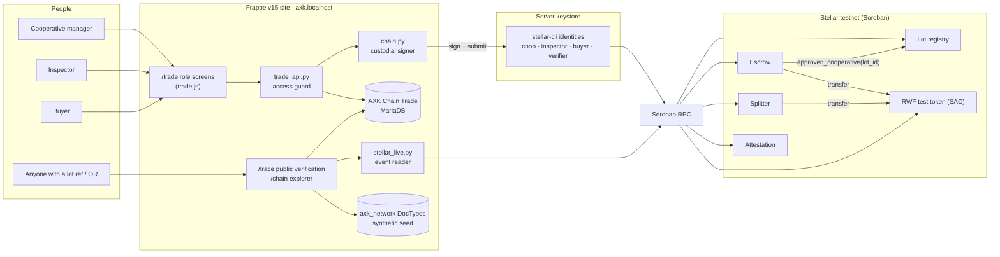
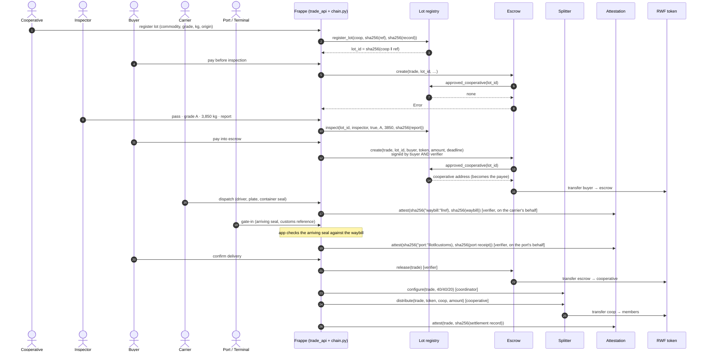
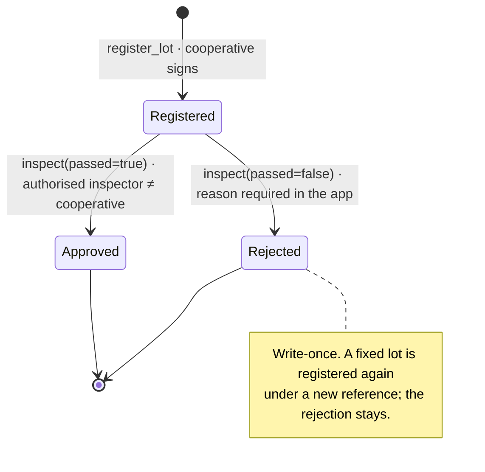
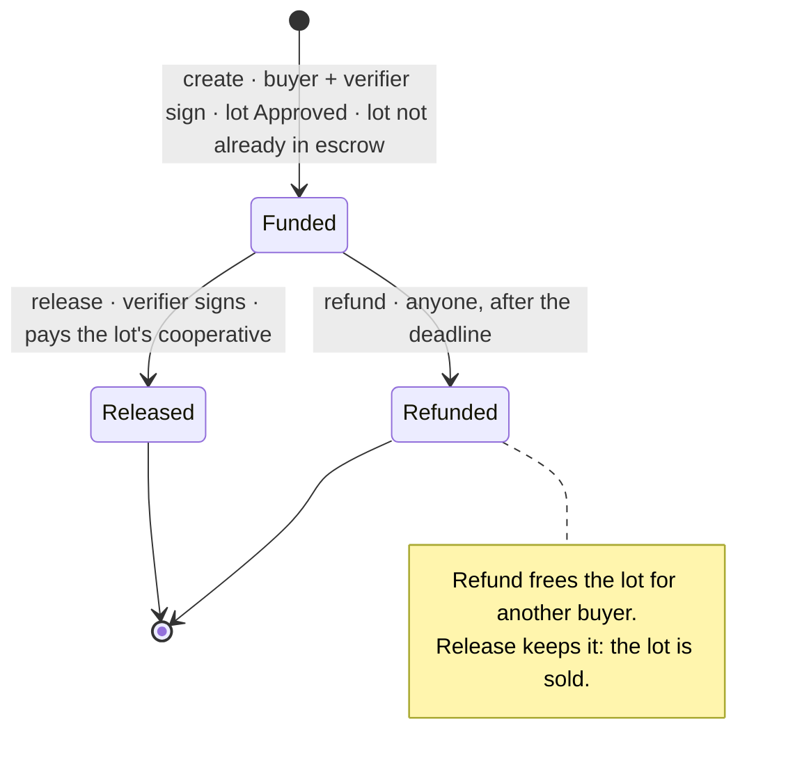
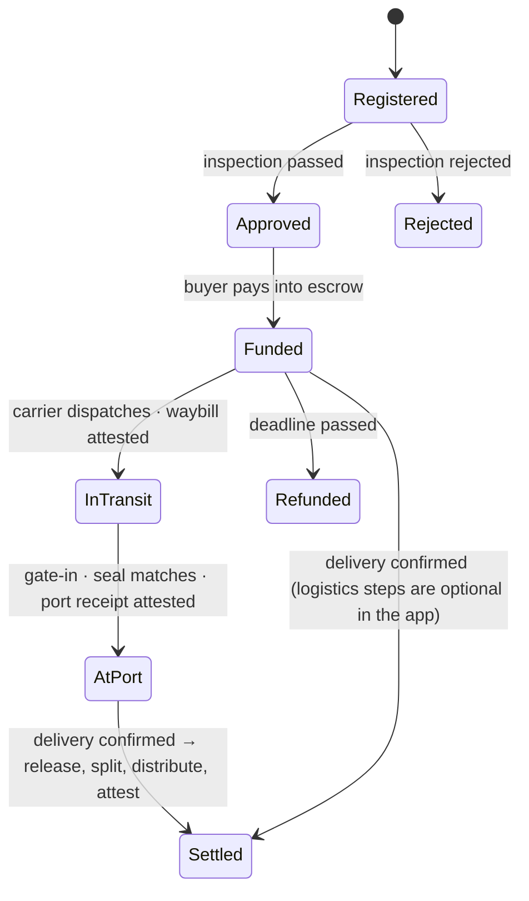
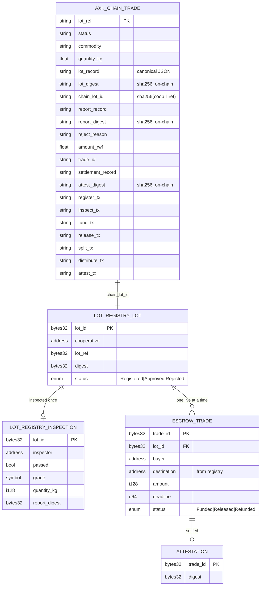

# Architecture

AXK Network's capstone layer: verify a commodity lot at source, hold the buyer's payment until delivery,
pay the cooperative's members, and let anyone check the result. Four Soroban contracts on Stellar
testnet do the enforcement; a Frappe app gives each role a screen and a public verification page.

## System schematic

| Layer | What it does | Where |
|---|---|---|
| Contracts | Enforce the rules: no inspection, no escrow; payee fixed by the registry; write-once records | `contracts/` |
| Signing | Builds and signs each role's transaction with a server-held testnet key, via `stellar-cli` argument lists (no shell) | `frappe_app/axk_capstone/axk_capstone/chain.py` |
| API | Validates input, enforces who may sign, stores every transaction hash | `trade_api.py` |
| Screens | Cooperative, Inspector, Buyer, Logistics, Port / Terminal, lot timeline | `www/trade/`, `public/js/trade.js` |
| Public | Lot search, read-only verification page with QR, chain explorer | `www/trace/`, `www/chain.*`, `stellar_live.py` |

## One verified trade

## State machines

### Lot (lot registry)

### Escrow (per trade)

### AXK Chain Trade (the app's record of one lot)

## Data model

Only the right-hand side lives on-chain, and it holds digests and addresses, never the records.
The canonical JSON records stay in Frappe; anyone holding one can hash it and ask the contract
`matches(id, digest)`.

## Data sources on screen

| Screen | Source | Real or synthetic |
|---|---|---|
| `/trade/*`, `/trace/*` | AXK Chain Trade + Stellar testnet | **Real testnet transactions** |
| `/chain` · settlement, verified-before-paid | Soroban RPC events | **Real testnet transactions** |
| `/chain` · hash-chain explorer, five-year history | `axk_network` DocTypes, `axk_seed` | **Synthetic**, labelled on the page |
